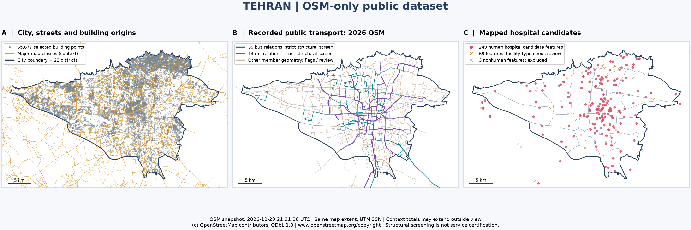

# Tehran Multilayer Robustness

Open research on street–route dependencies and structural healthcare accessibility in Tehran's multilayer transport network.

We study how street closures affect connections from mapped buildings to hospital candidates through walking, bus and metro layers. The project is being developed for a conference paper in complex networks.

**Status:** the screened-network baseline, every observed single closure, all 1,417,086 primary pairs, and the registered path/sensitivity stage are complete. The new record includes 19 exhaustive model variants and 11 SVG figures. Broader structural benchmarks, descriptive summaries, final claims and the conference manuscript remain open; results are structural observations on the mapped subset.

All-way length preservation, the exhaustive full-node solver comparison and final route-exclusion dispositions are documented in the [validation closure report](research/reports/validation-closure.en.md). Published experiment values are unchanged.

## Start here

- [Dataset, contents and provenance](data/README.md)
- [Research roadmap / TODO](TODO.md) — Persian
- [Research protocol](docs/research-protocol.fa.md) — Persian
- [Dataset construction report](docs/dataset-construction.fa.md) — Persian
- [Code and reproducibility](scripts/README.md)
- [Research implementation and commands](research/README.md)
- [Cumulative methods and results report — English, with SVG figures](research/reports/research-progress.en.md)
- [Exhaustive paired-closure protocol and results — English](research/reports/paired-closures.en.md)
- [Path certificates, exhaustive sensitivity and remaining-work ledger — English](research/reports/path-sensitivity.en.md)

```bash
git clone https://github.com/AliMoeinian/tehran-multilayer-robustness.git
cd tehran-multilayer-robustness
python scripts/verify_dataset.py
python scripts/verify_dataset.py --extract
```

Verification and extraction require Python 3.11+ and its standard library only. Open the extracted GeoPackage in a GIS application to explore the layers.

## What is shared

The repository bundles an **OSM-only public distribution** derived from the audited local v1.1 dataset, with its own manifest and checksums. It includes the OSM context PBF, eight GeoPackage layers, boundaries and quality registries. Historical IranTracking records and their derived crosswalks are not redistributed because an explicit redistribution license was not established. [Source details and exclusions](docs/provenance.md).



The model concerns structural connection opportunities, not observed trips, population-weighted demand, actual service availability or emergency response times. Quality flags and incomplete coverage remain explicit.

## Contributing and licensing

Please start with [CONTRIBUTING.md](CONTRIBUTING.md) and the roadmap before proposing changes.

Original code and project-authored documentation: [MIT](LICENSE). OSM source and derived databases: [ODbL 1.0](DATA_LICENSE.md), **© OpenStreetMap contributors**, distributed through [Geofabrik](https://download.geofabrik.de/asia/iran.html). The MIT license does not relicense third-party data. Attribution for the map: © OpenStreetMap contributors, ODbL 1.0; [copyright and license](https://www.openstreetmap.org/copyright).
