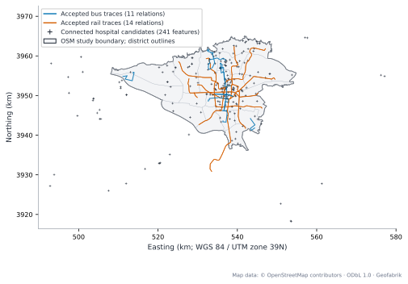
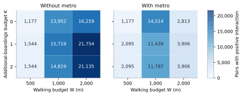
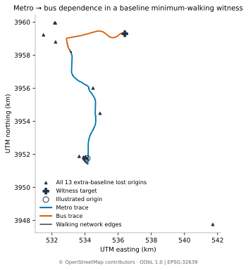

# Street–Route Dependencies and Structural Healthcare Accessibility Robustness in a Multilayer Network of Tehran

**Scientific draft 1 — 3 November 2026.** This is a complete first prose draft, not a submission-ready or venue-formatted paper. Author information, final panel composition and conference formatting remain open. The analytical snapshot is 29 October 2026, 21:21:26 UTC. Numerical sources and checks are recorded in [the draft review](manuscript-review.en.md); [references.bib](references.bib) provides the bibliography. Figure numbers below identify evidence panels, not finalized conference composites.

## Abstract

Street restrictions can remove several bus connections and eliminate alternatives that survive either restriction separately. We examine this dependency through constrained reachability from mapped buildings to healthcare candidates in Tehran. A frozen OpenStreetMap snapshot supplies an undirected walking network, 11 screened bus relations and 14 screened rail relations; these are a mapped subnetwork, not complete verified operating services. An asymmetric incidence relation connects source street segments to directed consecutive-stop bus arcs. We enumerate every single failure of 1,684 supporting segments and every 1,417,086 distinct segment pair under three cumulative walking budgets and three boarding budgets, with and without rail. At 1,000 m cumulative walking and at most two boardings, 26,360 building origins reach a candidate without rail and 29,105 with rail. Pair losses are decomposed into shared single-failure losses and origins lost only under joint failure. Both mechanisms occur for 11,433 pairs without rail and 10,430 with rail; they cancel in net interaction for 1,229 and 2,023 pairs, respectively. A separate signature diagnostic distinguishes repeated failed graphs from different dependency sets. Nineteen registered model variants expose sensitivity to connectors, route representation, targets and failure policy. The results provide an inspectable screening record for concurrent street restrictions within the observed subnetwork, rather than predictions of travel time, passenger disruption or clinical access.

**Keywords:** multilayer networks; infrastructure dependencies; pairwise failures; constrained reachability; public transport; Tehran.

## 1. Introduction

A street restriction can affect public transport beyond its immediate location. Several consecutive-stop bus connections may depend on the same street segment, while access to a destination may depend on alternatives supported by different segments. Reviewing restrictions one at a time can therefore miss an opportunity that disappears only when two restrictions occur together. Conversely, adding the losses from two individual restrictions can count the same affected origin twice. Distinguishing these mechanisms is useful when examining the network consequences of concurrent restrictions.

The practical motivation is service-continuity screening. A source-identifiable list of dependencies, affected building locations and explanatory paths can help analysts decide which restrictions warrant a closer joint review. Healthcare candidates provide a destination-specific functional endpoint: an origin either retains an eligible path to at least one mapped candidate or loses that opportunity. This endpoint is structural. It does not require assumptions about passenger numbers, hospital capacity or timetable adherence, and it does not estimate realized access to treatment.

Our study treats the recorded transport system as a multilayer path graph with one-way dependencies from bus connections to supporting street segments. We ask:

1. How do shared single-failure losses and losses arising only under joint failure combine across the complete observed pair domain?
2. How do these outcomes change when rail paths are available under the same failure and path constraints?
3. Which quantitative conclusions depend on the connector, route, target and failure conventions used to construct the model?

We answer these questions for a screened mapped subnetwork in Tehran using one frozen OpenStreetMap (OSM) snapshot. The contribution is the combined, auditable application of source-street dependencies, bounded building-to-candidate reachability, a complete physical-pair census, origin-set explanations and explicit representation sensitivity. We do not claim that multilayer transport models, destination-based criticality or nonadditive failures are new concepts. Completeness refers to enumeration within the declared model and failure domain, not to the city's operating transport network.

## 2. Related work and positioning

Destination-specific stress tests connect infrastructure disruption to the opportunities a network supports. [Schuster et al.](https://doi.org/10.1016/j.tra.2024.104017) examine road-network stress and medical-care access, and [Tariverdi et al.](https://doi.org/10.1038/s41598-023-28460-z) connect public-service accessibility and infrastructure criticality. Our endpoint differs through its walking/boarding constraints and explicit dependencies between source street segments and bus arcs. It is not an automobile or ambulance travel-time model.

Combined-link criticality is established in both road and transit research. [Wang et al.](https://doi.org/10.1080/23249935.2015.1137373) identify critical link combinations using a global optimization formulation; [Iliopoulou and Makridis](https://doi.org/10.1016/j.physa.2023.129100) formulate multi-objective multi-link transit disruption identification. [Liu and Miller](https://doi.org/10.1177/23998083241272098) measure route-removal accessibility contributions and describe nonlinear and nonlocalized effects. Our finite census complements these motivations by preserving origin-level shared and joint-only loss sets for every pair of the declared supporting segments. The set decomposition below is inclusion–exclusion, not a new theorem.

Multimodal dependencies and representation choices also have direct precedents. [Zhang et al.](https://doi.org/10.1016/j.ress.2023.109250) model bus-route and subway dependencies with dynamic coupled-map failures; [Boura and Ferguson](https://doi.org/10.1016/j.jtrangeo.2024.103934) incorporate geographic interdependencies into multimodal resilience assessment. [Gao and Blekanov](https://doi.org/10.3390/e28090976) use ordered route-preserving bus/metro hypergraphs. The representation review by [Palk et al.](https://doi.org/10.1002/net.70021) further motivates aligning a graph with its assessment question. We retain route occurrences and directed riding arcs in a state graph, with an explicit support-incidence relation. We do not introduce a new hypergraph cascade or reciprocal failure process.

The purpose of the outcome matters when choosing comparators. [Jafino et al.](https://doi.org/10.1080/01441647.2019.1703843) compare transport criticality metrics and discuss selection according to purpose. We consequently treat generic corridor betweenness as supporting descriptive evidence. Weak agreement with our functional score is neither a claim that centrality is generally ineffective nor a new discovery: the [supplied stress-test preprint, v1, Section 4.1](https://arxiv.org/html/2307.02250v1) already reports a small association for its own access-loss score. Its hospital-targeted origin–destination definition also differs from our uniform-junction comparator.

These comparisons draw on a [targeted narrative review](literature-and-claims.en.md) with explicit source versions and reading-depth limits. They are not a systematic proof of priority. External literature supplies context; none of its analytical records enters our model.

## 3. Data and model

### 3.1. Frozen source and study area

The analytical release is `tehran-osm-20261029T212126Z-v1.1-public`. Its raw context was reconstructed from a single Geofabrik Iran OSM snapshot dated 29 October 2026, 21:21:26 UTC. Missing referenced objects and relevant relations were recovered from that same snapshot rather than mixed across map vintages. The context rectangle is 50.9–51.95° E and 35.4–36.05° N. It supplies network context, not the city's definition.

We define the origin study area using OSM city relation 6663864 and retain the 22 associated district polygons. This is an explicit mapped definition of Tehran city; it has not been independently certified against a current legal municipal boundary. Buildings belong to the study when more than half of their footprint area lies inside the city. A numerical half-area tie is resolved by coverage of the stored representative point. Network paths are retained outside the city and may leave it and return. Connected healthcare candidates outside the city remain eligible within the available context.

Each retained building contributes one equal-weight origin at its stored representative location. There are 65,677 origins. Building counts represent mapped spatial opportunities, not population or travel demand. District descriptions retain 24 city origins in source-polygon gaps as unassigned rather than forcing a nearest district. Distances use EPSG:32639; stored source coordinates use EPSG:4326.

The primary analytical records are exclusively from this OSM release. A historical transport database inspected during preparation is neither an input nor redistributed; Google Maps, Neshan, Map.ir and Balad outputs are not included. Map attribution is © OpenStreetMap contributors, ODbL 1.0, distributed by Geofabrik. Detailed provenance and distribution terms accompany the [construction record](../../docs/dataset-construction.fa.md).

### 3.2. Eligibility, connectors and targets

An initial strict trace screen admitted 39 bus and 14 rail relations. A further audit reconstructed stop associations in recorded member order and checked their progress along oriented traces. The checks use a 100 m stop-to-trace limit, a 1 m projection-distance tolerance, a 20 m separation criterion for ambiguous progress locations, and a 1 m order tolerance. Stops were not silently reordered to obtain acceptance. The final primary connection model retains 11 bus and 14 rail relations; 28 bus relations have documented exclusions. All 28 fail the recorded-order contract, and one additionally has a 360.03 m distance violation. Exclusion is a model-eligibility decision, not evidence that a service does not operate. Relations represent recorded directions or representations and must not be counted as distinct operating lines.

There are 443 accepted stop occurrences and 418 directed consecutive-stop riding arcs: 138 bus and 280 rail. A stop occurrence belongs to a particular position in a relation. Distinct occurrences are not automatically merged into a physical station. Geometric walking access provides transfers; entry-only and exit-only roles constrain boarding and alighting.

An origin, target or stop is projected onto its nearest eligible walking way. The primary connector contract accepts offsets up to 100 m and charges the straight offset as walking distance. These are geometric associations, not verified entrances. Of the 65,677 origins, 64,166 have accepted connectors. All 1,511 rejected origins remain in the principal denominator with no eligible model path. Tag screening retains 249 human-healthcare candidate features; 241 connect successfully, belonging to 236 possible institution groups. The group labels address possible duplication and do not certify independent hospitals or emergency capabilities.

**Table 1. Primary model scope.** Source ways, graph edges, occurrences, features and possible groups are different counting units.

| Item | Count or convention |
| --- | ---: |
| Building-feature origins, fixed denominator | 65,677 |
| Origins with accepted geometric connectors | 64,166 |
| Connected healthcare candidate features / possible groups | 241 / 236 |
| Accepted bus / rail relation instances | 11 / 14 |
| Stop occurrences | 443 |
| Directed bus / rail riding arcs | 138 / 280 |
| Walking source ways | 206,474 |
| Walking vertices / stored undirected edges | 848,604 / 930,852 |
| Distinct supporting source street segments | 1,684 |
| Distinct unordered physical-segment pairs | 1,417,086 |
| Cumulative walking budgets W | 500, 1,000, 2,000 m |
| Additional-boarding budgets K | 0, 1, 2 |
| Total permitted boardings | At most K + 1 |



**Figure 1.** Accepted relation traces, city/district boundaries and connected candidate features from the frozen OSM source. The map describes the screened subnetwork, not complete operational coverage. Traces can extend outside the city. Candidate symbols are stored feature locations, not entrances. Walking edges and building points are omitted for legibility. Map data: © OpenStreetMap contributors, ODbL 1.0; Geofabrik distribution. The [eligibility funnel](../figures/progress-2026-11-01/01-route-screening.svg) supplies the relation-screening counts.

### 3.3. Multilayer paths and asymmetric support

The walking layer uses undirected consecutive-node adjacency with projected length as cost. Original OSM node identity controls intersections: geometric crossings alone do not create connections. Inserting connector anchors splits source segments while preserving their lengths. The resulting graph follows the stored walking-candidate policy; permissions and barriers have not been independently verified at every location.

Each transit layer uses directed consecutive-stop arcs. Staying aboard through a stop does not consume a new boarding. Alighting and boarding another vehicle use the walking layer and its connector costs; reboarding the same relation consumes a new boarding. Riding contributes zero to the *walking-distance objective*. It does not imply zero travel time, and total riding distance is not bounded by W.

Let E be the 1,684 source street units and A_bus the accepted bus arcs. Each e in E is identified by its source way ID and unordered adjacent native-node pair. Thus separate source ways remain separate even if they use the same node pair. For arc a, let D(a) be its support set: source segments having positive overlap with its recorded trace interval. An endpoint touch alone does not create support. The data contain 1,895 dependency occurrences.

A failure set F disables exactly those bus arcs for which D(a) intersects F. Other bus arcs, walking and rail remain fixed. This models a restriction on bus passability and local loss of recorded connections. It does not assert a pedestrian barrier or a citywide hazard footprint. Retained route fragments represent structural riding possibilities, not a guarantee of actual partial-route operation. No rerouting, capacity redistribution or reciprocal cascade is simulated. Whole-relation deletion is evaluated separately as a different failure convention.

## 4. Methods

### 4.1. Constrained reachability and loss

Let B be the fixed origin set and H the connected target features. For mode set m and failure set F, d_m(i,F,K) is the minimum cumulative walking distance from origin i to any target in H using at most K + 1 boardings. Walking includes origin and destination offsets, walking edges, and every boarding/alighting offset used. Define

```math
R_m(F;W,K)=\{i\in B:d_m(i,F,K)\leq W\},
\qquad A_m(F;W,K)=|R_m(F;W,K)|/65{,}677.
```

The bus model permits walking and bus; the full model additionally permits rail, including the retained OSM train-tagged Tehran line 5 representation. Walking-only paths are eligible in both. We evaluate all nine W/K combinations. K is an additional-boarding budget, not a schedule-based transfer count. The reference presentation uses W = 1,000 m and K = 1, allowing at most two total boardings.

For fixed m, W and K, suppress these indices and define the lost-origin set L(F) = R(∅) \ R(F), with loss count ℓ(F) = |L(F)|. The share loss is ℓ(F)/65,677. A rejected connector is distinct from a failure-induced loss: an origin inaccessible in the intact model cannot enter L(F). Missing paths within a constraint are not claims of global disconnection.

### 4.2. Origin-set decomposition of pair interaction

Deleting bus arcs cannot add eligible paths. Consequently L({e}) and L({f}) are subsets of L({e,f}). For each distinct physical pair, define the counts

```math
S_{ef}=|L(\{e\})\cap L(\{f\})|,
\qquad N_{ef}=|L(\{e,f\})\setminus(L(\{e\})\cup L(\{f\}))|.
```

S counts origins lost under either single closure; N counts origins surviving both single-closure scenarios but lost under their joint closure. Inclusion–exclusion gives

```math
C_{ef}=\ell(\{e,f\})-\ell(\{e\})-\ell(\{f\})=N_{ef}-S_{ef}.
```

A positive C means that new joint-only losses exceed shared losses. A negative C describes overlap relative to adding the single losses; it does not mean a closure improves access. Zero C can mean N = S > 0, so the net score alone can hide two nonzero mechanisms. Even N = S = 0 can accompany positive additive joint loss. We report the full four-category N/S census rather than equating zero interaction with no damage.

### 4.3. Complete enumeration and exact grouping

We enumerate all 1,684 singles and all binomial(1,684, 2) = 1,417,086 unordered pairs of distinct physical source units. A single's dependency signature is the set of bus arcs it disables. The 1,684 units have 238 distinct signatures. Pair evaluation uses the union of the two signatures; repeated failed graphs are solved once and restored with exact physical multiplicity. There are 28,337 represented signature pairs and 27,849 distinct pair-union failed sets. Compression does not sample streets, pairs or origins.

Different streets can have identical signatures. Their joint failure equals either individual failure, giving N = 0 and C = −ℓ({e}) by construction. We retain these valid physical pairs in the primary domain and report them separately to distinguish this identity from outcomes involving different signatures. Neither signatures nor physical pairs are treated as independent statistical replicates or equally probable incidents.

### 4.4. Solver and verification

A reverse multi-source walking Dijkstra, seeded with target offsets, produces the zero-boarding distance vector. At each additional boarding layer, eligible alighting occurrences seed backward propagation through directed riding arcs. Eligible boarding anchors then seed walking Dijkstra. Retaining the previous layer gives an at-most-b boarding solution. Nonnegative costs, directed riding and boarding/alighting restrictions are enforced throughout. The maximum walking search cutoff is 2,000 m; an infinite stored distance means outside that search domain, not proof of disconnection at arbitrary walking distance.

The compact solver reuses equivalent walking-distance structure and intact states. Full-node comparison covers 27,857 primary failed sets, both mode sets, four boarding layers and all 64,166 connected origins: 14,299,778,096 origin/layer cells. Published threshold classifications agree exactly; the independent floating-point comparison has maximum finite-distance discrepancy approximately 1.14 × 10⁻¹² m. A compiled replay also reproduces the results. Exactness here means complete finite-domain evaluation with validated numerical computation, not symbolic arithmetic or perfect source mapping.

Path interpretation includes all tied minimum/maximum interaction signature cases at the reference setting and all seven negative modal-benefit signatures. The registered case domain yields 7,155 unique origin/state/mode certificates and 2,984 successful witness paths. Independent replay checks direction, connector costs, boarding permissions, failed-arc exclusion and target identity. These are complete selected-case certificates, not a census of witnesses for every pair or every tied path.

### 4.5. Modal comparison and sensitivity

For matched F, define M(F) = |R_full(F)| − |R_bus(F)|. Nested eligible path sets imply M(F) ≥ 0 by construction. Its change from the intact state is

```math
\Delta M(F)=M(F)-M(\varnothing)=\ell_{bus}(F)-\ell_{full}(F).
```

If Q is the bus-baseline loss set rescued by the full model, and T is the full-model loss set outside the intact bus-accessible set, then ΔM = |Q| − |T|. Negative ΔM is therefore compatible with higher absolute accessibility in the full model. It compares loss relative to different intact opportunity sets; it is not a Braess paradox.

The registered sensitivity suite contains 18 common-domain variants including the reference, plus one source-way aggregation experiment. It varies connector limits, deterministic nearest-way tie choices, origin location, target selection, available context, failure policy and route eligibility/order. Every common-domain variant preserves all 65,677 origins and enumerates all original 1,684 singles and 1,417,086 pairs across all nine settings and both modes. Expanded route models remain evaluated on this common primary failure universe, not all their additional supporting streets. The separate aggregation covers 310 OSM ways and all 47,895 way pairs. These are one-factor comparisons, not a full Cartesian product, probability distribution or equal-length damage experiment.

## 5. Results

### 5.1. Baseline opportunities and individual failures

At the reference setting, walking alone connects 25,295 origins to a target. Bus raises the count to 26,360 and the full model to 29,105. At least two possible target groups are reachable from 11,522, 13,528 and 18,404 origins, respectively. Group multiplicity describes mapped candidate alternatives, not independent treatment capacity. All counts retain the same 65,677-origin denominator.

Single closures cause positive losses for 757 bus-model units and 667 full-model units. Maximum single losses are 224 and 219 origins. Maximum joint losses are 439 and 351. These maxima can occur under different physical scenarios, so subtracting them is not a paired estimate of rail protection. The comparatively small bus increment must also be read in the context of only 11 retained bus relation instances; it does not measure all Tehran bus services.

### 5.2. Pair losses contain distinct mechanisms that can cancel

**Table 2. Complete physical-pair mechanism census at W = 1,000 m, K = 1.** The first four rows are disjoint and exhaustive. The balanced row is a subset of “both” and is not added again.

<!-- BEGIN MANUSCRIPT_MECHANISMS -->
| Mechanism category | Bus | Bus + rail |
| --- | ---: | ---: |
| Shared only: S > 0, N = 0 | 42,379 | 40,872 |
| Joint-only: N > 0, S = 0 | 14,579 | 9,516 |
| Both: N > 0, S > 0 | 11,433 | 10,430 |
| Neither: N = S = 0 | 1,348,695 | 1,356,268 |
| Total physical pairs | 1,417,086 | 1,417,086 |
| Balanced nonzero, N = S > 0: subset of both | 1,229 | 2,023 |
<!-- END MANUSCRIPT_MECHANISMS -->

The four-category census shows why positive interaction and joint-only loss are different summaries. There are 26,012 bus-model pairs with N > 0, but only 15,719 with C > 0; corresponding full-model counts are 19,946 and 11,439. Where both mechanisms occur, shared losses can outweigh, equal or fall below new losses. In particular, 1,229 bus pairs and 2,023 full-model pairs have nonzero mechanisms that exactly cancel. Counting only positive C would omit their joint-only losses, while counting only N would omit the offsetting shared component.

For bus, C ranges from −224 to 192; for the full model, from −219 to 41. In the maximum-positive bus interaction case, joint loss is 406, with S = 0 and N = 192. The same signature-pair case has full-model joint loss 41 and N = 35. This matched example illustrates substitution by full-model paths, whereas separate maxima summarize different scenarios. Every tied registered extremum is retained in the explanatory evidence.



**Figure 2.** Counts of physical pairs with positive net interaction (C > 0) across every evaluated walking/boarding setting in both mode sets. Each cell is computed from all 1,417,086 physical supporting-segment pairs, with exact multiplicity restored from signature grouping. The heatmap shows only positive-C counts; Table 2 reports all four mechanism categories at the reference setting. [The companion origin-set panels](../figures/sensitivity-2026-11-02/pair-mechanisms-all-extrema.svg) show S and N for every registered extremum. Extremum cases are deliberately selected explanations, not prevalence estimates or representative incidents.

### 5.3. Identical signatures do not account for all pair mechanisms

Exactly 16,289 physical pairs have identical single-failure signatures. At the reference setting they have no joint-only losses and no positive C, as the model identity requires. They include 8,357 negative-C bus pairs and 7,945 negative-C full-model pairs; the remaining pairs have zero C.

The remaining 1,400,797 different-signature pairs include all 15,719 bus and 11,439 full-model positive-C pairs. They also contain 43,086 and 39,411 negative-C pairs and all 26,012 and 19,946 N > 0 pairs. Thus the origin-set mechanisms persist beyond identical failed-graph pairs. This diagnostic preserves the complete physical domain as the principal denominator while making the repeated-signature contribution explicit. Different signatures are not assumed to produce independent outcomes.

### 5.4. Modal differences have inspectable but representation-sensitive paths

In the primary model, 98 single units produce greater absolute loss with rail than without it, relative to each mode set's own intact baseline. These units occupy seven dependency signatures. All seven share 13 lost origins that are accessible only in the intact full model. At the same time, full-model alternatives rescue six or seven bus-baseline losses, giving ΔM = −7 or −6. Replayed intact witnesses for the additional origins use rail followed by bus. The interpretation is a dependence of some rail-enabled opportunities on a final bus connection; full-model accessibility remains at least bus-model accessibility under each matched failure.

This pattern is not stable across route representations. At the reference setting, both the semantic-extension and geometric derived-order variants have zero units with greater full-model absolute single loss, compared with 98 in the primary representation. The witness mechanism is therefore certified for the primary graph, not generalized as a cost of metro or as an operational finding.



**Figure 3.** One certified path illustrating the primary model's rail-to-bus support dependence, selected from the registered seven-signature explanation domain. It demonstrates a possible model mechanism, not a recorded passenger itinerary. All relevant origins and signatures are retained in the underlying evidence. The disappearance of the 98-unit excess-loss pattern under both expanded route variants is a necessary qualification of this case.

### 5.5. Model conventions materially change quantitative outcomes

**Table 3. Selected sensitivity results at the reference setting.** Each row uses the same original 1,684-unit failure universe and all its pairs. Maxima need not refer to the same pairs across columns or variants. Connector limits apply to origins, targets and stop access together.

<!-- BEGIN MANUSCRIPT_SENSITIVITY -->
| Variant | Healthy bus | Healthy full | Max pair loss, bus | Max pair loss, full | Units with greater full single loss |
| --- | ---: | ---: | ---: | ---: | ---: |
| Primary contract | 26,360 | 29,105 | 439 | 351 | 98 |
| Connector limit 25 m | 15,142 | 18,589 | 557 | 249 | 74 |
| Connector limit 250 m | 26,686 | 29,461 | 439 | 351 | 98 |
| Whole-relation failure | 26,360 | 29,105 | 648 | 427 | 209 |
| Emergency-tag targets | 8,774 | 13,684 | 912 | 868 | 47 |
| Inside-city human targets | 26,356 | 29,101 | 439 | 351 | 98 |
| Semantic route extension | 27,781 | 30,604 | 438 | 344 | 0 |
| Geometric derived order | 30,927 | 32,712 | 398 | 285 | 0 |
<!-- END MANUSCRIPT_SENSITIVITY -->

The 25 m connector convention substantially reduces intact reachability; its change cannot be attributed only to building attachment because target and stop access change too. Whole-relation deletion increases the maximum joint loss relative to local arc deletion, but it is a different service-failure convention rather than a calibrated operational bound. Changing to emergency-tag targets changes both opportunity counts and disruption consequences; the tags do not independently verify emergency service.

The semantic-extension variant retains 17 bus and 16 rail relations; the derived-order hypothesis retains 38 bus and 14 rail. Sorting geometrically projected stops is an explicit alternative assumption, not a verified repair of the recorded member order. Neither variant silently replaces the primary model. The two deterministic nearest-way tie policies and all four nested context variants reproduce the reference baseline/single/pair count tables exactly on the evaluated grids. This context agreement establishes agreement within available records, not the absence of useful paths beyond the extract.

Across all 19 registered variants, 25,555,443 physical-pair scenarios yield 459,997,974 mode/parameter evaluations. These numbers describe complete declared domains, not independent observations or an uncertainty interval. The [full sensitivity figure](../figures/sensitivity-2026-11-02/sensitivity-maximum-losses.svg) and [technical report](../reports/path-sensitivity.en.md) retain the unabridged grids.

### 5.6. Supporting structural comparison

The separate corridor comparator uses every stored context highway/path way, with length-weighted shortest paths and uniform demand over 317,724 original junction/endpoints. Geometry-only degree-two vertices contribute no new origin–destination demand. All projected sources of the block-cut computation are completed; no sampled centrality prefix is used. Each primary failure unit is mapped to its containing corridor chain.

At the reference setting, single-unit loss has Spearman association 0.0949 with corridor betweenness in the bus model and −0.0256 in the full model. Positive-top-5% sets, including cutoff ties, have zero Jaccard overlap in both comparisons. Actual loss/benchmark set sizes are 50/85 and 47/85. The comparator and functional score differ in their origin–destination demand, modes and target meaning; these are descriptive disagreements, not evidence of predictive superiority. Complete grids and [structural figures](../reports/structural-comparisons.en.md) remain supporting material.

## 6. Discussion

The complete census supports a mechanism-based interpretation of two-street disruption. A net interaction score answers whether combined loss exceeds the sum of individual losses. It does not by itself identify which origins survive each single closure, which are shared losses, or whether opposing components cancel. Reporting S and N alongside C preserves that information. The balanced cases make the distinction concrete without requiring an assumption about incident probabilities.

The repeated-signature diagnostic addresses an important representational issue. OSM subdivides streets into source segments, several of which may disable the same bus arcs. Their subadditivity is then an identity. Keeping physical multiplicity preserves the chosen failure domain; separating the identity stratum avoids presenting it as an independent combined-failure mechanism. Different-signature pairs still exhibit joint-only losses and offsetting components. This does not establish invariance to a new segmentation or to equal physical damage budgets, which were not tested.

Rail provides additional eligible paths in this model, so its nonnegative matched accessibility contribution follows from construction. The empirical questions concern the size of those opportunities and their dependence on bus support. A rail-to-bus witness identifies a dependency that a mode-level summary would hide, but the associated excess-loss pattern disappears in the expanded route representations. This sensitivity is a substantive result about what the screened map supports, and it limits the prominence of that case in the general conclusion.

For service-continuity analysts or teams reviewing concurrent restrictions, the deliverable is a screening record: identifiable source segments, dependent bus arcs, affected origins, joint-loss sets and explanatory paths. It can direct attention to dependencies requiring closer review. It does not select an operational closure schedule or justify closing roads with low scores. Applying it to an agency decision would require current service and site information held by that agency; such information is outside this study.

Relative to previous healthcare stress tests and multimodal dependency studies, the contribution is an inspectable case-based combination of source-level support, constrained destination reachability, exhaustive paired scenarios and interpretation under alternative contracts. The algebraic decomposition, broad nonadditivity and possibility of multimodal substitution are established ideas. Our evidence supplies their measured distribution and limitations in this frozen mapped subnetwork.

## 7. Limitations and reproducibility

The accepted relations are not a random or representative sample of Tehran services. Strict eligibility excludes many relations and does not establish whether retained services operated on the snapshot date. OSM source topology, walking eligibility, healthcare labels and the city boundary remain map-based conventions. Missing population, demand, timetables and capacity are consistent with the structural endpoint; they preclude extending the results to realized passenger effects, travel-time reliability, emergency response or clinical access.

Geometric connectors are not entrances. Riding length and time are not constrained, and a shortest-walking witness need not be an attractive trip. Fixed walking and rail isolate bus support failure; they do not represent every physical consequence of closing a street. Local retained bus fragments and whole-relation deletion are alternative structural policies without observed operator validation. One-factor sensitivity exposes selected convention dependence but does not establish all combined-assumption effects or quantify real-world uncertainty.

The failure universe comprises supporting source segments of the primary accepted bus arcs, not all Tehran streets. Physical unit and pair averages are segmentation-dependent and have no probability interpretation without a failure distribution. Buildings and pairs share network structure, so no independent-replicate p-values are attached. Grouped target counts are possible mapped institutions rather than independent clinical choices. Optional larger-failure curves, equal-length failure budgets and combined-factor experiments have not been executed and are not part of the reported evidence.

The public [repository](https://github.com/AliMoeinian/tehran-multilayer-robustness) supplies source identities, construction decisions, configuration, necessary code, full result tables, replay receipts and editable SVGs. [Claim evidence](claim-evidence.json) is rebuilt solely from frozen outputs by `build_claim_evidence.py --check`. Full-node numerical and geometry audits are distinguished from the narrower checks repeated in continuous integration. Exact finite-domain enumeration and successful replay support computational consistency; they do not certify real-world completeness. This draft adds no new analytical data or network simulation.

## 8. Conclusion

In the screened Tehran subnetwork, street-to-bus dependencies produce pair losses containing both shared and joint-only origin effects. Their cancellation makes a zero net interaction compatible with nonzero competing mechanisms. These patterns persist beyond identical dependency signatures. Rail-enabled opportunity differences can be traced to specific paths, but their interpretation depends on recorded route representation. Connector, target and failure-policy sensitivity therefore belong alongside the main results. The resulting open evidence supports structured review of concurrent restrictions within the declared mapped domain.
