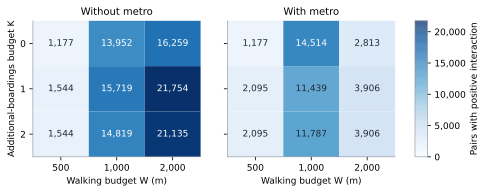
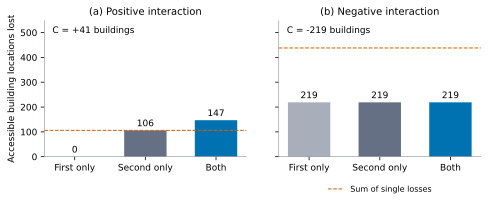

# Exhaustive paired street closures: methods and results

**Date:** 1 November 2026. This extends the [cumulative methods report](research-progress.en.md) with the same frozen OSM data, origin/target sets, connectors, weights and failure policy. **All unordered distinct pairs of the 1,684 observed bus-supporting street segments are included. There is no sampling or runtime-based scope reduction.**

## 1. Domain and interaction

The domain contains **1,417,086 physical street pairs**. It is partitioned into **28,337 pairs of single-failure signatures**, including pairs of different streets with the same signature. These produce **27,849 distinct unions of failed bus-connection IDs**. A total of 16,289 physical pairs share one single signature. Every physical pair has weight one; a signature-pair result is weighted by the number of physical pairs it represents.

For each pair, count-based interaction is:

```math
C_N(e,f)=L_N(\{e,f\})-L_N(\{e\})-L_N(\{f\}).
```

A positive value means joint loss exceeds the sum of single losses. A negative value means subadditivity or overlapping losses. Divide by 65,677 to express interaction in full-denominator accessibility-share units. This is a deterministic structural interaction, not evidence of a dynamic cascade or a probability of real failures.

The pair disables the union of its dependent consecutive-stop bus connections. Walking and metro remain fixed and buses do not reroute. The two mode sets use identical pairs and W/K values. The census covers the defined observed street domain, not all streets or all operating services in Tehran.

## 2. Complete computation and physical-pair identity

The [protocol](../config/pair-protocol.json) explicitly requires exhaustive computation regardless of runtime. Benchmark timings are diagnostics only. Reusing an exactly identical failed graph is an algebraic reduction, not subsampling: all physical and signature-pair identities remain represented.

The solver evaluates all nine W/K combinations for both walking-plus-bus and walking-plus-bus-plus-metro. The output contains **250,641 union-effect rows**, each with both mode counts. The full expanded experiment represents 12,753,774 physical-pair/parameter combinations and 25,507,548 physical-pair/parameter/mode results. The separate layers avoid duplicating identical calculations while retaining exact reconstruction.

Every physical pair is also explicitly enumerated in `physical-pairs.csv.gz`. Its two street indices resolve through `street-index.csv.gz`; its union ID resolves through `unions.csv.gz` and `union-effects.csv.gz`. Constituent single losses resolve through the street signatures and the earlier exhaustive single-closure table. Pairs sharing a failed union can still have different interaction because their two constituent single losses can differ.

<!-- BEGIN EXECUTION -->
The completed run used **4 worker processes** and took **664.4 seconds** on the local machine. All **27,849 union scenarios** and **28,337 signature pairs** are present; their weights sum to **1,417,086 physical pairs**. Runtime is descriptive, not a guaranteed performance bound.
<!-- END EXECUTION -->

## 3. Exact stop-metric contraction and parallel execution

The original solver operates on 848,604 walking nodes. We precompute its fixed walking metric between relevant anchors and contract the repeated walking subproblems. The compact representation has 423,879 sparse origin-to-stop incidences, stop-to-target costs, and a stop-to-stop transfer matrix. All geometric connectors and cumulative walking costs are included. No approximate geometry, float32 conversion, or distance rounding is introduced.

For each boarding budget, reverse directed riding propagation finds the best downstream alighting option. Walking transfers connect that option to the previous boarding layer. Sparse grouped minima reconstruct all connected-origin costs while retaining walking-only and lower-budget options. Boarding roles, disabled modes, rejected access connectors and onboard passage keep their original meaning.

Independent union scenarios are distributed across four Python worker processes. Each worker uses the same deterministic formulas and tests boarding-budget and added-metro monotonicity at every origin-cost layer. Parallelism changes which CPU evaluates a scenario; it does not partition the domain by sampling. Parent-side reference cases check worker serialization and evaluation against previously validated values. Incremental checkpoints are local execution-recovery evidence; the published final tables contain the complete census.

## 4. Validation scope

The validation milestone used **44 passing unit tests**, including actual subprocess-worker equivalence and closure propagation. The [path/sensitivity extension](path-sensitivity.en.md) brings the local suite to 48. The compact solver was also checked against the full graph and independent forward expanded-state search on small generated graphs, totaling 1,440 origin/budget/scenario comparisons. The original baseline tests and the single-closure tests remain in the suite.

On the Tehran model, the compact solver reproduces the baseline and every W/K count for all 238 single-failure signatures. Nine real scenarios additionally compare full connected-origin cost vectors with the original solver: the baseline, five fixed single signatures and three fixed pair unions. Numeric tolerance is 1e-8 m absolute and 1e-12 relative; threshold counts must match exactly. This selected full-solver comparison is not an exhaustive cross-solver check of every union. The separate all-scenario controls are described below; the [completed follow-up census](validation-closure.en.md) now supplies the full-node comparison for every failed set and the full source-length census.

The independent output audit enumerates **every one of the 1,417,086 physical pairs** with Cartesian products/combinations, rather than the runner's unranking helper. It compares every saved rank, street identity and union ID, verifies absence of missing/extra rows, reconstructs all 28,337 multiplicities, and checks all 27,849 dependency unions. It then checks every effect row, all nine parameter combinations, mode and budget monotonicity, joint-loss bounds, every signed interaction distribution, summary and illustrated extreme case. All input and artifact identities are checked. These checks establish completeness and internal consistency within the model; they do not certify service activity, hospital operations or real entrances.

<!-- BEGIN AUDIT -->
**Independent audit: passed.** Every physical pair was verified. All **250,641 effect rows**, **28,337 signature pairs**, **27,849 union scenarios**, and **18 parameter/mode summaries** reconciled.
<!-- END AUDIT -->

## 5. Results

The following table is the readability slice W=1,000 m and K=1. Both columns refer to the **same complete physical-pair domain**.

<!-- BEGIN MAIN -->
| Measure | Walking + bus | Walking + bus + metro |
| --- | --- | --- |
| Negative-interaction pairs | 51,443 | 47,356 |
| Zero-interaction pairs | 1,349,924 | 1,358,291 |
| Positive-interaction pairs | 15,719 | 11,439 |
| Minimum C (buildings) | -224 | -219 |
| Maximum C (buildings) | 192 | 41 |
| Mean C (buildings) | -0.437564 | -0.545187 |
| Maximum joint loss (buildings) | 439 | 351 |
<!-- END MAIN -->

The full grid is reported below. Counts and means use equal physical-pair weights. Extremes are domain extremes within the modeled pair experiment, not bounds on real-world disasters.

<!-- BEGIN GRID -->
| K | W (m) | Mode | C < 0 | C = 0 | C > 0 | Min C | Max C | Max joint loss |
| --- | --- | --- | --- | --- | --- | --- | --- | --- |
| 0 | 500 | Bus | 61,390 | 1,354,519 | 1,177 | -210 | 7 | 361 |
| 0 | 500 | Bus + metro | 61,390 | 1,354,519 | 1,177 | -208 | 7 | 359 |
| 0 | 1,000 | Bus | 49,731 | 1,353,403 | 13,952 | -224 | 192 | 437 |
| 0 | 1,000 | Bus + metro | 37,281 | 1,365,291 | 14,514 | -219 | 41 | 370 |
| 0 | 2,000 | Bus | 10,819 | 1,390,008 | 16,259 | -153 | 15 | 198 |
| 0 | 2,000 | Bus + metro | 5,593 | 1,408,680 | 2,813 | -153 | 6 | 182 |
| 1 | 500 | Bus | 63,211 | 1,352,331 | 1,544 | -229 | 25 | 387 |
| 1 | 500 | Bus + metro | 62,958 | 1,352,033 | 2,095 | -227 | 25 | 383 |
| 1 | 1,000 | Bus | 51,443 | 1,349,924 | 15,719 | -224 | 192 | 439 |
| 1 | 1,000 | Bus + metro | 47,356 | 1,358,291 | 11,439 | -219 | 41 | 351 |
| 1 | 2,000 | Bus | 6,800 | 1,388,532 | 21,754 | -153 | 33 | 193 |
| 1 | 2,000 | Bus + metro | 9,495 | 1,403,685 | 3,906 | -153 | 27 | 182 |
| 2 | 500 | Bus | 63,211 | 1,352,331 | 1,544 | -229 | 25 | 387 |
| 2 | 500 | Bus + metro | 62,958 | 1,352,033 | 2,095 | -227 | 25 | 383 |
| 2 | 1,000 | Bus | 49,567 | 1,352,700 | 14,819 | -224 | 192 | 439 |
| 2 | 1,000 | Bus + metro | 46,804 | 1,358,495 | 11,787 | -219 | 41 | 351 |
| 2 | 2,000 | Bus | 6,800 | 1,389,151 | 21,135 | -153 | 28 | 193 |
| 2 | 2,000 | Bus + metro | 9,495 | 1,403,685 | 3,906 | -153 | 27 | 182 |
<!-- END GRID -->



**Figure 6.** Number of pairs with positive interaction across the complete W/K grid, out of all 1,417,086 pairs in each cell. Both panels share the color scale. The unit is a physical source-segment pair; equivalent signatures retain their full multiplicity. No statistical uncertainty from pair sampling is involved. Data coverage and modeling uncertainty remain. [SVG](../figures/pairs-exhaustive-2026-11-01/01-positive-pair-interaction.svg).

### Traceable extreme cases

<!-- BEGIN EXAMPLES -->
In the full model at W=1,000 m and K=1, a maximum-interaction case has single losses **0** and **106**, joint loss **147**, and C = **+41** building locations (union ID **26049**). A minimum-interaction case has single losses **219** and **219**, joint loss **219**, and C = **-219** (union ID **22066**). Both are traceable in [extreme-cases.json](m4-pairs-exhaustive-2026-11-01/extreme-cases.json).
<!-- END EXAMPLES -->



**Figure 7.** Maximum- and minimum-interaction signature-pair examples in the full model at W=1,000 m and K=1. Bars are first-only, second-only and joint losses; the dashed line is the sum of single losses. These are deliberately selected extremes, not representative cases. Exact signatures, union IDs and physical multiplicities are in the linked extreme-case file. [SVG](../figures/pairs-exhaustive-2026-11-01/02-pair-interaction-examples.svg).

The arithmetic establishes nonadditivity. A geographic explanation, such as a particular feeder or alternative-path mechanism, still requires explicit path tracing. Added-metro accessibility is never worse for a matched scenario, but neither interaction nor the change in loss is required to improve with metro.

## 6. Public evidence and reproduction

- [Complete summary and hashes](m4-pairs-exhaustive-2026-11-01/summary.json), [protocol snapshot](m4-pairs-exhaustive-2026-11-01/protocol.json), [complete-domain selection record](m4-pairs-exhaustive-2026-11-01/selection.json), and [independent audit receipt](m4-pairs-exhaustive-2026-11-01/audit.json).
- [Every physical pair](m4-pairs-exhaustive-2026-11-01/physical-pairs.csv.gz), [street index](m4-pairs-exhaustive-2026-11-01/street-index.csv.gz), [signature pairs](m4-pairs-exhaustive-2026-11-01/signature-pairs.csv.gz), [dependency unions](m4-pairs-exhaustive-2026-11-01/unions.csv.gz), and [all union effects](m4-pairs-exhaustive-2026-11-01/union-effects.csv.gz).
- [Signed interaction distributions](m4-pairs-exhaustive-2026-11-01/interaction-distributions.json) and [extreme cases](m4-pairs-exhaustive-2026-11-01/extreme-cases.json).
- [Figure data](../figures/pairs-exhaustive-2026-11-01/figure-data.json) and [figure hashes](../figures/pairs-exhaustive-2026-11-01/manifest.json).
- [Compact solver](../src/compact_accessibility.py), [pair runner](../src/pair_closures.py), [independent audit](../src/audit_pairs.py), and [figure generator](../src/make_pair_figures.py).

After preparing the matching frozen network and single-closure results:

```bash
python -m unittest discover -s tests -v
python -m research.src.pair_closures --protocol research/config/pair-protocol.json --output research/runs/<new-complete-run> --workers 4
python -m research.src.audit_pairs --directory research/runs/<new-complete-run>
python -m research.src.make_pair_figures
```

The exhaustive protocol prohibits automatic runtime-based scope reduction. Output directories refuse overwrite. Gzip CSVs use UTF-8, canonical line endings and fixed compression metadata. Source/configuration identities and every final data file have hashes. Figure sources are fully vector SVG with editable text and recorded source hashes. CPU scheduling and elapsed time are not scientific inputs, and byte-identical rebuilding across every platform is not asserted.

## 7. Remaining work

This completes the **pair domain**, not every later stage of the paper. The study still uses 11 accepted bus and 14 rail relations, equal building weights, tag-screened targets, geometric connectors and a static dependency rule. It does not become complete operational coverage merely because every pair was evaluated.

The broader preservation/cross-solver checks are [completed](validation-closure.en.md). Path certificates and the registered sensitivity/ranking stage are also [completed](path-sensitivity.en.md), with an explicit ledger of the broader structural benchmarks and descriptive analyses still open in the original roadmap. Final conference claim/figure selection and manuscript work remain pending. No further external data entered these experiments.
