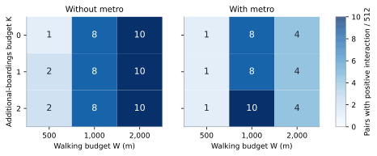
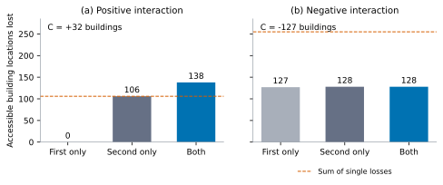

# Paired street closures: protocol, exact contraction, and sampled results

**Date:** 1 November 2026. This extends the [cumulative methods report](research-progress.en.md) using the same frozen OSM dataset, targets, connectors, origin weights and failure policy. No external records were added. The single-closure domain is exhaustive; the paired-closure results below are **a fixed sample**, not an exhaustive analysis.

## 1. Question and interaction measure

For two distinct source street segments, we ask whether their joint accessibility loss differs from the sum of their individual losses. In building-count units:

```math
C_N(e,f)=L_N(\{e,f\})-L_N(\{e\})-L_N(\{f\}).
```

Positive values indicate a joint loss larger than the sum of single losses. Negative values indicate overlap or subadditivity. Divide by 65,677 to obtain accessibility-share interaction. The sign does not establish a dynamic cascade, a failure probability, or a causal mechanism outside the model. Two modes are always compared on the same pair and W/K values.

A pair removes the union of the two streets' dependent consecutive-stop bus connections. Walking and metro stay fixed, and no bus rerouting is introduced. Pairs are unordered and contain distinct source segments. Two different segments sharing one dependency signature remain a valid pair: they can produce exactly the same failed graph as either single closure, with negative interaction when that single loss is positive.

## 2. Domain enumeration and selection recorded before interaction analysis

The 1,684 observed street units yield **1,417,086 distinct unordered pairs**. They are represented by **28,337 single-signature pairs**, including diagonal combinations with at least two distinct streets. There are **27,849 distinct unions of failed connection IDs**. Of these, 231 can reuse a single-closure scenario and 27,618 are new union scenarios. A total of 16,289 physical street pairs share the same single-failure signature.

The [protocol](../config/pair-protocol.json) set a runtime-based scope rule before paired interaction results were summarized: benchmark 128 evenly spaced new union scenarios; use exhaustive enumeration if the projected solver time is at most 900 seconds, otherwise sample 512 physical street-pair ranks uniformly without replacement with seed **20261101**. The first benchmark measured about 0.0482 seconds per union, projecting about 1,331 seconds for the new unions. The recorded decision therefore selected the fixed sample. The threshold was a computation-scope choice, not a statistical power calculation.

Sampling is uniform over physical street pairs, not uniform over signatures. Canonical blocks enumerate signature pairs in source order. Cross-signature blocks use the Cartesian product of their ordered street lists; same-signature blocks use lexicographic combinations. Saved ranks identify exact pairs under this convention. The publication includes the [initial scope decision](m4-pairs-2026-11-01/initial-scope-decision.json), [fixed selection](m4-pairs-2026-11-01/selection.json), and actual street identifiers for every sampled pair.

The sample covers **512 distinct physical pairs**, represented by **482 signature pairs and 482 union scenarios**. Each union was evaluated over all nine W/K combinations in both mode sets, yielding 4,338 union-effect rows with two mode counts per row. Repeat occurrences in a signature-pair block retain their sampled multiplicity. We report empirical counts and extrema within this sample. We do not treat signature-equivalent pairs as independent observations or extrapolate the sample maxima to the entire domain. Rare positive interactions are particularly uncertain at this sample size.

## 3. Exact walking-metric contraction

Running the original 848,604-node walking solver for every union would repeatedly solve identical walking subproblems. We instead precompute shortest walking distances, under the existing 2,000 m search cutoff, between relevant walking anchors. No new transfer links, distance rounding, or approximate geometry is introduced.

The contracted model stores:

- The walking-only origin-to-target cost and the target cost at each stop, including connector offsets.
- A stop-to-stop walking matrix, charging alighting access, walking distance, and boarding access.
- Sparse origin-to-stop walking incidences, charging the origin and boarding offsets. The current model has **423,879** such incidences.

For each boarding budget, reverse directed riding propagation finds the best downstream alighting option. A stop-to-stop minimum then connects that option to the previous boarding-budget layer. Origin costs are reconstructed by a sparse grouped minimum over their reachable boarding stops, with walking-only and lower-budget options retained. Entry-only, exit-only, rejected walking connectors, disabled modes and onboard passage have the same semantics as the original solver. Vehicle motion still costs zero walking distance; no travel-time assertion is made.

This is a shortest-path contraction of the fixed walking layer. It preserves the modeled origin costs mathematically. Floating-point costs are checked with absolute tolerance 1e-8 m and relative tolerance 1e-12; **threshold counts must agree exactly**. These tolerances are numerical checks, not a spatial uncertainty model.

## 4. Validation and saved-output audit

The current suite has **36 passing unit tests**. New tests compare the compact solver with both the original full-graph solver and an independent forward expanded-state search on 30 small random graphs, before and after arc deletion: 1,440 origin/budget/scenario comparisons. Other examples check rejected-connector through-riding, origin offsets, disabled modes, same-signature pairs, pair-rank reconstruction, union grouping, and positive, negative and zero interaction.

On the actual Tehran model, the compact solver reproduced the complete W/K grid for the baseline and **all 238 published single-failure signatures**. Full-graph origin-cost vectors were additionally compared for nine scenarios: the baseline, five deterministically spaced single signatures, and three deterministically spaced benchmark unions. At every budget, all 64,166 connected-origin costs matched within the stated tolerances and threshold counts matched exactly. Full node-vector equivalence was not exhaustively checked for every possible pair.

Mode and boarding-budget monotonicity checks ran for every evaluated compact scenario. At aggregation, every joint loss was checked to be at least either constituent single loss. An independent saved-output audit reconstructed the seeded ranks and physical pair identities using Cartesian products/combinations rather than the runner's unranking helper. It checked union membership, completeness of all 4,338 effect rows, input/artifact hashes, mode dominance, constituent-loss bounds, all interaction distributions, and all summary counts. This audit passed for all 18 parameter/mode comparisons. These checks concern implementation and saved evidence; they do not certify operational transit activity or hospital service.

## 5. Results

At W=1,000 m and K=1, the sample results are:

| Measure | Walking + bus | Walking + bus + metro |
|---|---:|---:|
| Negative-interaction pairs | 15 | 12 |
| Zero-interaction pairs | 489 | 492 |
| Positive-interaction pairs | 8 | 8 |
| Minimum interaction, building locations | −127 | −127 |
| Maximum interaction, building locations | +32 | +32 |
| Mean interaction, building locations | −0.506 | −0.592 |
| Maximum joint loss in the sample, building locations | 344 | 339 |

All rows use the same 512 sampled physical pairs. The two sample maxima need not be attached to the same pair. Negative means do not rule out positive interactions or identify a dynamic mechanism.



**Figure 6.** Counts of sampled pairs with positive interaction among the same 512 pairs at every W/K combination. Color limits are shared between mode panels. The full parameter summaries and signed distributions are in the linked machine-readable evidence. These counts are not an exhaustive census of positive-interaction pairs. [SVG](../figures/pairs-2026-11-01/01-positive-pair-interaction.svg).

Positive interaction varies with walking and boarding budgets. For example, at K=1 the bus-only sample contains 2, 8 and 10 positive pairs for W=500, 1,000 and 2,000 m; the model including metro contains 1, 8 and 4. This sample does not support a universal claim that metro removes pair interaction or that one walking budget gives the strongest general vulnerability.

### Two traceable arithmetic examples

In a selected full-model case at W=1,000 m and K=1, one single loss is zero and the other is 106 building locations; the joint loss is 138. The interaction is therefore **+32**. Three sampled physical pairs share that signature-pair case. An edge with zero single loss can therefore still participate in a positive interaction within this sample.

In a selected negative case, single losses are 127 and 128; the joint loss is 128, giving **−127**. The sum of separate losses counts some inaccessible opportunities more than once. These are arithmetic interpretations of structural accessibility, not yet verified geographic or operational explanations. Geographic path tracing remains necessary before assigning a specific redundancy or feeder mechanism to named infrastructure.



**Figure 7.** Two observed full-model signature-pair examples at W=1,000 m and K=1. Bars show the first-only, second-only and joint building-location losses; the dashed line is the sum of single losses. The examples were selected as the maximum and minimum interaction cases within the sample, rather than as representative cases or full-domain extrema. Their signatures, multiplicities and union IDs are saved in [extreme-cases.json](m4-pairs-2026-11-01/extreme-cases.json). [SVG](../figures/pairs-2026-11-01/02-pair-interaction-examples.svg).

## 6. Evidence and reproducibility

- [Summary, domain and input identities](m4-pairs-2026-11-01/summary.json), [protocol snapshot](m4-pairs-2026-11-01/protocol.json), and [signed interaction distributions](m4-pairs-2026-11-01/interaction-distributions.json).
- [Actual sampled streets](m4-pairs-2026-11-01/sampled-street-pairs.csv.gz), [signature-pair multiplicities](m4-pairs-2026-11-01/signature-pairs.csv.gz), [union membership](m4-pairs-2026-11-01/unions.csv.gz), and [union effects](m4-pairs-2026-11-01/union-effects.csv.gz). These are deterministic gzip-compressed UTF-8 CSV files, readable with Python `gzip`/`csv` or a standard archive tool.
- [Figure source data](../figures/pairs-2026-11-01/figure-data.json) and [figure checksum manifest](../figures/pairs-2026-11-01/manifest.json).
- Implementation: [compact solver](../src/compact_accessibility.py), [pair runner](../src/pair_closures.py), [independent output audit](../src/audit_pairs.py), and [figure generator](../src/make_pair_figures.py).

After the existing frozen model has been prepared:

```bash
python -m unittest discover -s tests -v
python -m research.src.pair_closures --output research/runs/<new-pair-run> --selection research/reports/m4-pairs-2026-11-01/selection.json
python -m research.src.audit_pairs --directory research/runs/<new-pair-run>
python -m research.src.make_pair_figures
```

The `--selection` option fixes the published sample even on hardware where a fresh runtime-based decision would choose a different scope. Omitting it runs the recorded selection rule anew. The input network must match the published single-closure identity; this is deliberately checked. The publication retains the initial timing-based decision and the subsequent fixed-sample reproduction. Output hashes, code hashes, exact ranks and identifiers are retained. As in earlier stages, output directories refuse overwrite, and code validation is separate from universal byte-identical rebuilding across platforms.

## 7. What comes next

The sampled pair stage demonstrates nonadditive effects within the same fixed dataset and failure mechanism. It does not complete the sensitivity work or establish the prevalence and extrema of interaction over all 1.4 million pairs.

The next analysis should explain the positive/negative examples and the seven earlier negative-DeltaM single signatures with explicit origin/path tracing. It should then test the connector convention, budget choices and alternative failure policies using the same source data. A later exhaustive or larger fixed pair run can use the contracted solver, but it needs an explicit scope amendment and a clear distinction from this archived sample. Claims about ranking stability and final conference conclusions remain pending.
