# Path explanations and exhaustive model sensitivity

**Record completed:** 2 November 2026 (Asia/Tehran). This report extends the [cumulative methods/results](research-progress.en.md), [exhaustive paired closures](paired-closures.en.md), and [complete primary-model validation](validation-closure.en.md). It uses only the frozen public OSM dataset. No new operational, population, timetable or healthcare records enter the analysis.

## 1. What this stage completes

The registered [sensitivity protocol](../config/sensitivity-protocol.json) contains 18 one-factor variants, including the reference, plus one separate source-way aggregation. Every common-domain variant covers all 1,684 primary source segments and all 1,417,086 unordered distinct physical pairs, at all nine W/K settings and both mode sets. The source-way test covers all 310 supporting OSM ways and all 47,895 unordered way pairs. Across the 19 variants there are **25,555,443 physical-pair scenarios**, expanded to **459,997,974 mode/parameter results**. Computation groups only exactly identical failed-connection sets; it does not sample streets, pairs, origins or W/K settings.

Path interpretation covers all tied minimum/maximum interaction signature pairs at W=1,000 m, K=1 in either mode and all seven negative-DeltaM single signatures. All affected origins in those registered cases are included. This case domain deliberately concerns extrema and the metro interpretation, not every positive-loss pair in the census. One shortest-walking witness is retained per reachable origin/state; enumerating every tied path is unnecessary for a reachability certificate and is not claimed.

The previous full-node/compact census remains valid and primary experiment values are unchanged. A further complete compilation audit checks all 27,857 primary failed sets, both modes, four boarding layers and 64,166 connected origins: **14,299,778,096 cells**, maximum discrepancy **0.0 m**, with every published threshold count reproduced. Compilation uses float64 and disables fastmath.

## 2. Exact origin-set explanation of pair interaction

Let A0 be the intact accessible-origin set and Le=A0\Ae the origins lost after closure e. Under edge deletion, Le and Lf are subsets of Lef, the joint-loss set. Define S=Le intersect Lf and N=Lef\(Le union Lf). Inclusion-exclusion gives **C=|Lef|-|Le|-|Lf|=|N|-|S|**. S describes losses counted twice by adding single losses. N describes origins that survive either single closure but fail under both. Negative C is overlap of losses, not a beneficial effect of closing streets. Positive C is net joint-only loss; it can coexist with shared losses.

The complete [mechanism table](sensitivity-2026-11-01/all-pair-mechanisms.csv.gz) has 510,066 signature-pair/mode/parameter rows, with exact physical-pair multiplicities. Every N and S is nonnegative and every interaction reconciles. The origin bitsets are [retained](sensitivity-2026-11-01/single-loss-masks.npz) with an explicit [origin/signature index](sensitivity-2026-11-01/mask-index.json). These are deterministic set counts, not independent statistical replicates.

At W=1,000 m, K=1, bus-only pairs comprise 42,379 shared-only, 14,579 joint-only, 11,433 with both mechanisms, and 1,348,695 with neither. The corresponding full-layer counts are 40,872, 9,516, 10,430 and 1,356,268. Each row of four totals 1,417,086. A pair with both mechanisms may have positive, negative or zero net C.

### All registered extrema

| Case | Mode | Union loss | Shared single losses | New joint-only losses | C |
| --- | --- | --- | --- | --- | --- |
| pair-0 | bus | 406 | 0 | 192 | 192 |
| pair-0 | bus_metro | 41 | 0 | 35 | 35 |
| pair-1 | bus | 224 | 224 | 0 | -224 |
| pair-1 | bus_metro | 219 | 219 | 0 | -219 |
| pair-2 | bus | 224 | 224 | 0 | -224 |
| pair-2 | bus_metro | 219 | 219 | 0 | -219 |
| pair-3 | bus | 224 | 224 | 0 | -224 |
| pair-3 | bus_metro | 219 | 219 | 0 | -219 |
| pair-4 | bus | 224 | 224 | 0 | -224 |
| pair-4 | bus_metro | 219 | 219 | 0 | -219 |
| pair-5 | bus | 147 | 0 | 41 | 41 |
| pair-5 | bus_metro | 147 | 0 | 41 | 41 |
| pair-6 | bus | 147 | 0 | 41 | 41 |
| pair-6 | bus_metro | 147 | 0 | 41 | 41 |
| pair-7 | bus | 147 | 0 | 41 | 41 |
| pair-7 | bus_metro | 147 | 0 | 41 | 41 |

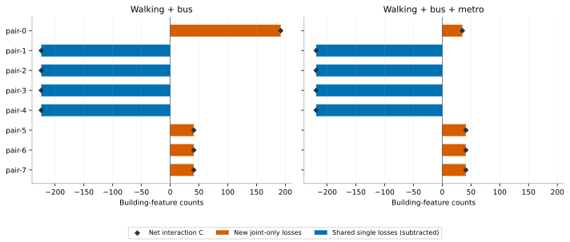

The eight signature-pair cases preserve all tied extrema. Their physical multiplicities and full failed-connection identities are in the [case registry](sensitivity-2026-11-01/path-case-registry.json). They are not eight equally probable real incidents, and repeated equivalent graphs are not independent evidence.

## 3. Path reconstruction and independent replay

`path_witnesses.py` adds predecessor forests to the original full-node reverse dynamic program. Walking Dijkstra records the next graph edge toward the selected target or boarding seed. Onboard reverse propagation records a directed consecutive-stop connection. An alighting event reduces the remaining boarding budget by one. Inherited cheaper states retain the previous layer. Strict improvements, including on zero-cost edges, avoid cycles in the selected predecessor forest. The objective remains minimum cumulative walking with at most two boardings for these cases; no speed or waiting time is assigned.

For every requested failed-set/mode state, the reconstructed full-node distances are compared against the compact origin vectors for all 64,166 connected origins and all three layers (0, 1 and 2 boardings), including finite/infinite patterns and the 1,000 m classification. There are 44 such state/mode requests and 8,469,912 origin-layer comparisons. Maximum discrepancy is 1.14e-12 m. All threshold classifications agree.

The output contains **3,437 case/origin memberships**, **7,155 unique origin/state/mode certificates**, and **2,984 successful paths**. The remainder are explicit failures under the walking/boarding constraint. Null minimum walking means no path within the 2,000 m search cutoff, not global disconnection. Finite values above 1,000 m also fail the selected constraint.

An independent replay reads graph records afresh and checks every walking edge endpoint, source connection direction, permitted mode, boarding/alighting permission, failed-connection exclusion, target identity, boarding ledger and summed walking cost. Maximum replay discrepancy is 5.68e-13 m. It also reconstructs coordinates and checks **all 930,852 primary walking edges** and **all 64,850 accepted connectors**. Synthetic split-node IDs are reconstructed from primary way progress; they are never copied by ID from a differently split model. Maximum geometric discrepancies are 4.58e-10 m for edges and 2.39e-10 m for connectors.

Artifacts: [all witnesses](sensitivity-2026-11-01/path-witnesses.jsonl.gz), [case memberships](sensitivity-2026-11-01/path-case-members.csv.gz), [failed sets](sensitivity-2026-11-01/path-failed-sets.json), [path summary](sensitivity-2026-11-01/path-summary.json), [independent replay/geometry audit](sensitivity-2026-11-01/path-audit.json), [descriptive riding lengths](sensitivity-2026-11-01/path-ride-profiles.csv.gz). Walking edge IDs refer to the frozen model and are accompanied by the used-edge and coordinate tables.

### Maps of every affected origin in the extreme cases

All markers use actual EPSG:32639 coordinates. The panels are windows around affected origins, so causal source-closure segments may be outside the displayed windows. Grey lines show accepted route traces. These maps display all affected origins in each case; overlapping markers are not a density estimate. The loss and interaction counts are supplied beside the maps and in the complete membership table.

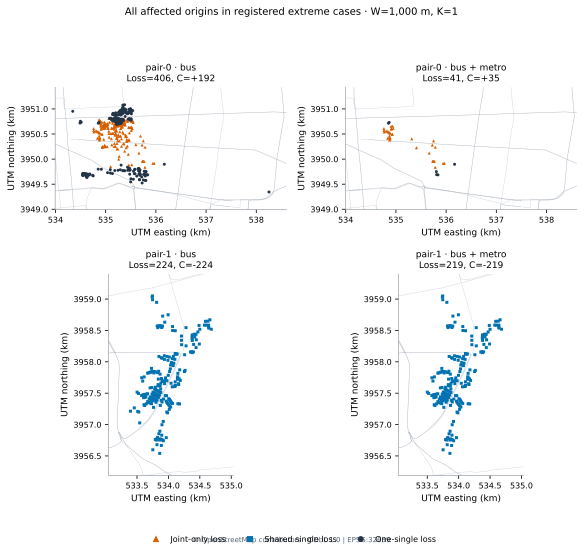

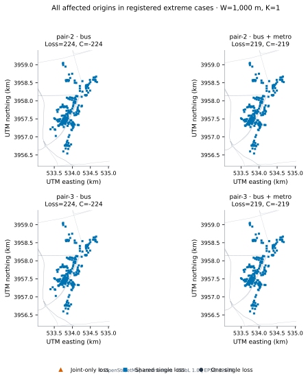

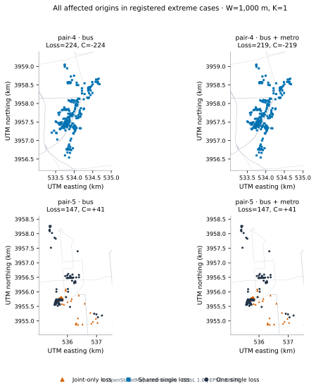

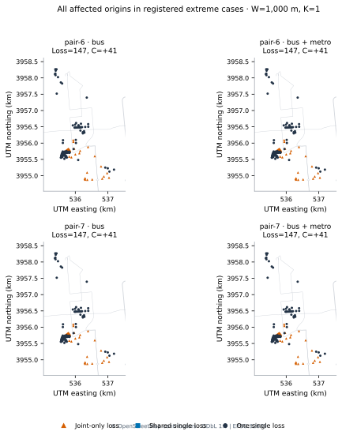

## 4. Why the metro-benefit change can be negative

The intact accessible sets satisfy Abus subset Afull. For a matched failure, define R as bus-baseline losses rescued by the full-layer model, and E as lost full-baseline origins outside the intact bus accessible set. Then **DeltaM=Lbus-Lfull=|R|-|E|**. Thus a negative change in metro benefit is compatible with full-layer access being at least bus-only access in every intact and failed state. It does not show that adding metro physically worsens accessibility.

| Group | Physical streets | Bus L | Full L | Bus losses rescued | Extra baseline lost | DeltaM |
| --- | --- | --- | --- | --- | --- | --- |
| 105 | 1 | 21 | 28 | 6 | 13 | -7 |
| 106 | 4 | 21 | 28 | 6 | 13 | -7 |
| 107 | 1 | 25 | 31 | 7 | 13 | -6 |
| 108 | 8 | 25 | 31 | 7 | 13 | -6 |
| 109 | 1 | 51 | 57 | 7 | 13 | -6 |
| 110 | 82 | 51 | 57 | 7 | 13 | -6 |
| 111 | 1 | 51 | 57 | 7 | 13 | -6 |

All seven groups share 13 extra-baseline lost origins; 6 or 7 bus-baseline losses are rescued. The saved full-baseline witnesses for those extra origins use **metro then bus**, exposing a last-mile bus dependency. This is a verified model path mechanism, not evidence of actual passenger itineraries, capacity cascades or operational service failure. The seven groups represent 98 physical source segments. No negative case is omitted.

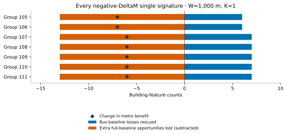

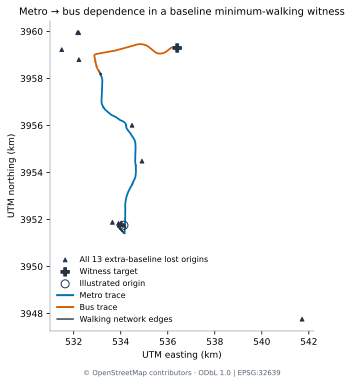

The last map selects the lexicographically first extra-baseline origin in group 105 to illustrate one certificate; this illustration is not the sample used for any quantitative result. All 13 extra-baseline locations are plotted. Platform/stop-to-trace projection is a mapping association; it is not an additional walking leg in the model. The linework can therefore have small geometric gaps at mapping associations. The model charges the documented walking-network access offsets.

Across all 2,984 successful certificates, descriptive riding lengths have median 2.61 km, 95th percentile 4.83 km and maximum 23.54 km. These certificates are selected by walking cost, not minimum total length. Their distribution pertains to this case/witness set and must not be described as a citywide trip-length distribution. No riding-length or time feasibility bound is claimed.

## 5. Sensitivity design and construction

The 18 common-domain variants change one registered factor relative to the frozen model. They are not a Cartesian product or a probabilistic uncertainty distribution. All use the same ordered universe of 65,677 equal-weight building features. Rejected connectors remain in the denominator with infinite accessibility cost. The common failure universe stays the 1,684 primary supporting source segments, even when an expanded route set has additional supporting streets. Consequently the expanded-route results are exhaustive **on the common primary exposure domain**, not on every newly introduced dependency street.

- **Connector limits:** 25, 50, 100 (reference) and 250 m. Limits apply to origins, targets and boarding/alighting access. Through-riding is retained at inaccessible stops. A shared 250 m split graph is filtered for the smaller limits; extra degree-two split vertices preserve walking distances. The reference variant reproduces every earlier published baseline, single and pair threshold count.
- **Equal-nearest alternatives:** deterministic minimum-way-ID and maximum-way-ID policies evaluate every equal-nearest choice returned by STRtree. These are two explicit policies, not lower/upper bounds on all possible entrances. There are 431 entities with multiple nearest-way matches in these builds.
- **Origin location:** the stored representative point is replaced by the WGS84 footprint centroid, then projected to EPSG:32639. This is a geometric sensitivity assumption, not an estimated entrance. There are 426 centroids outside their own footprint; they are retained as a deliberately different location convention and reported, not called valid interior points.
- **Targets:** all screened human hospital candidates (reference), the emergency-tag subset, human candidates inside the city, and the emergency-tag subset inside the city. The network and origin universe stay fixed. These are tag/geometry definitions, not clinically verified emergency capability.
- **Context:** the available graph is restricted to city masks buffered by 1, 3, 5 and 10 km. Entire stored walking edges, geometric access connectors and riding-trace intervals must be covered. No geometry is extended beyond the available source. Agreement with the full extract indicates convergence only within this available context; unseen roads outside the extract remain untested.
- **Failure semantics:** local consecutive-stop bus-arc deletion (reference), deletion of every accepted connection of each affected recorded bus relation, and an independent-bus counterfactual that deletes no bus connections. Walking and metro remain fixed in all three. The last case is a mechanism control, not a claim that actual bus service ignores street closures.
- **Route subset:** a semantic-extension build includes continuously traced flagged relations only when their recorded stop order passes the same checks; the resulting model has 17 bus and 16 rail relations. A separate geometric-order hypothesis sorts uniquely projected stops along strict traces, while retaining the original source-member index, yielding 38 bus and 14 rail relations. The latter is an explicit reconstruction assumption, not verified operation or a silent source repair. The 360.03 m offset route remains excluded. Expanded models do not replace the frozen 11-bus/14-rail primary model.
- **Segmentation:** every supporting source way aggregates its dependent primary segments, yielding a distinct 310-unit, 47,895-pair experiment. It is reported separately because its failures have different physical lengths and meanings.

Six network builds support these comparisons. Every build passed a complete source-way/split-chain length census, with the receipts, configuration hashes, network hashes, route/stop evidence for the expanded models, and construction summaries in [model-builds.json](sensitivity-2026-11-01/model-builds.json) and its linked model-audit directories. Component summaries preserve their local build-stage wording; their historical pending fields are not the status of the complete research workflow.

| Variant | Connected origins | Targets | Active ride arcs | Bus / rail relations | Signature groups | Pairs |
| --- | --- | --- | --- | --- | --- | --- |
| baseline | 64166 | 241 | 418 | 11 / 14 | 238 | 1,417,086 |
| connector-25m | 46771 | 118 | 418 | 11 / 14 | 238 | 1,417,086 |
| connector-50m | 60643 | 203 | 418 | 11 / 14 | 238 | 1,417,086 |
| connector-250m | 65530 | 248 | 418 | 11 / 14 | 238 | 1,417,086 |
| tie-min-way | 64166 | 241 | 418 | 11 / 14 | 238 | 1,417,086 |
| tie-max-way | 64166 | 241 | 418 | 11 / 14 | 238 | 1,417,086 |
| origin-centroid | 64158 | 241 | 418 | 11 / 14 | 238 | 1,417,086 |
| targets-emergency-tag | 64166 | 37 | 418 | 11 / 14 | 238 | 1,417,086 |
| targets-human-inside | 64166 | 184 | 418 | 11 / 14 | 238 | 1,417,086 |
| targets-emergency-inside | 64166 | 26 | 418 | 11 / 14 | 238 | 1,417,086 |
| context-1km | 64166 | 186 | 410 | 11 / 14 | 238 | 1,417,086 |
| context-3km | 64166 | 192 | 412 | 11 / 14 | 238 | 1,417,086 |
| context-5km | 64166 | 192 | 414 | 11 / 14 | 238 | 1,417,086 |
| context-10km | 64166 | 201 | 418 | 11 / 14 | 238 | 1,417,086 |
| failure-whole-route | 64166 | 241 | 418 | 11 / 14 | 13 | 1,417,086 |
| failure-independent-bus | 64166 | 241 | 418 | 11 / 14 | 1 | 1,417,086 |
| routes-semantic-extension | 64166 | 241 | 531 | 17 / 16 | 242 | 1,417,086 |
| routes-derived-order | 64166 | 241 | 886 | 38 / 14 | 254 | 1,417,086 |
| whole-osm-way | 64166 | 241 | 418 | 11 / 14 | 171 | 47,895 |

## 6. Full-domain numerical results

The tables below use W=1,000 m and K=1, selected in the original protocol. Every value is a building-feature count. The full W/K grids for every variant are in each [variant directory](sensitivity-2026-11-01/variants/), with single effects, paired effects, exact groups/unions, source units/lengths and summary receipts. No result row is estimated from a sample.

### Walking + bus

| Variant | Healthy access | Positive single units | Max single L | Max paired L | Min C | Max C | C > 0 pairs | C < 0 pairs |
| --- | --- | --- | --- | --- | --- | --- | --- | --- |
| baseline | 26360 | 757 | 224 | 439 | -224 | 192 | 15719 | 51443 |
| connector-25m | 15142 | 601 | 360 | 557 | -358 | 185 | 10027 | 35314 |
| connector-50m | 24216 | 757 | 221 | 435 | -221 | 192 | 15263 | 51443 |
| connector-250m | 26686 | 757 | 224 | 439 | -224 | 192 | 15719 | 51443 |
| tie-min-way | 26360 | 757 | 224 | 439 | -224 | 192 | 15719 | 51443 |
| tie-max-way | 26360 | 757 | 224 | 439 | -224 | 192 | 15719 | 51443 |
| origin-centroid | 26367 | 757 | 222 | 433 | -222 | 196 | 16031 | 47390 |
| targets-emergency-tag | 8774 | 868 | 596 | 912 | -410 | 43 | 16139 | 70385 |
| targets-human-inside | 26356 | 757 | 224 | 439 | -224 | 192 | 15719 | 51443 |
| targets-emergency-inside | 8774 | 868 | 596 | 912 | -410 | 43 | 16139 | 70385 |
| context-1km | 26360 | 757 | 224 | 439 | -224 | 192 | 15719 | 51443 |
| context-3km | 26360 | 757 | 224 | 439 | -224 | 192 | 15719 | 51443 |
| context-5km | 26360 | 757 | 224 | 439 | -224 | 192 | 15719 | 51443 |
| context-10km | 26360 | 757 | 224 | 439 | -224 | 192 | 15719 | 51443 |
| failure-whole-route | 26360 | 1337 | 424 | 648 | -424 | 196 | 120780 | 138932 |
| failure-independent-bus | 26360 | 0 | 0 | 0 | 0 | 0 | 0 | 0 |
| routes-semantic-extension | 27781 | 737 | 224 | 438 | -224 | 192 | 19711 | 47495 |
| routes-derived-order | 30927 | 707 | 229 | 398 | -229 | 212 | 20869 | 50295 |
| whole-osm-way | 26360 | 153 | 261 | 485 | -224 | 195 | 611 | 2257 |
### Walking + bus + metro

| Variant | Healthy access | Positive single units | Max single L | Max paired L | Min C | Max C | C > 0 pairs | C < 0 pairs |
| --- | --- | --- | --- | --- | --- | --- | --- | --- |
| baseline | 29105 | 667 | 219 | 351 | -219 | 41 | 11439 | 47356 |
| connector-25m | 18589 | 613 | 166 | 249 | -166 | 63 | 13594 | 33680 |
| connector-50m | 27303 | 667 | 217 | 346 | -217 | 40 | 11439 | 47478 |
| connector-250m | 29461 | 667 | 219 | 351 | -219 | 41 | 11439 | 47356 |
| tie-min-way | 29105 | 667 | 219 | 351 | -219 | 41 | 11439 | 47356 |
| tie-max-way | 29105 | 667 | 219 | 351 | -219 | 41 | 11439 | 47356 |
| origin-centroid | 29123 | 650 | 217 | 350 | -217 | 40 | 13098 | 44415 |
| targets-emergency-tag | 13684 | 793 | 586 | 868 | -421 | 75 | 15788 | 59665 |
| targets-human-inside | 29101 | 667 | 219 | 351 | -219 | 41 | 11439 | 47356 |
| targets-emergency-inside | 13684 | 793 | 586 | 868 | -421 | 75 | 15788 | 59665 |
| context-1km | 29105 | 667 | 219 | 351 | -219 | 41 | 11439 | 47356 |
| context-3km | 29105 | 667 | 219 | 351 | -219 | 41 | 11439 | 47356 |
| context-5km | 29105 | 667 | 219 | 351 | -219 | 41 | 11439 | 47356 |
| context-10km | 29105 | 667 | 219 | 351 | -219 | 41 | 11439 | 47356 |
| failure-whole-route | 29105 | 1315 | 219 | 427 | -219 | 38 | 120780 | 136919 |
| failure-independent-bus | 29105 | 0 | 0 | 0 | 0 | 0 | 0 | 0 |
| routes-semantic-extension | 30604 | 569 | 212 | 344 | -212 | 41 | 8391 | 34800 |
| routes-derived-order | 32712 | 655 | 157 | 285 | -157 | 155 | 18401 | 47739 |
| whole-osm-way | 29105 | 134 | 219 | 351 | -219 | 41 | 509 | 2154 |

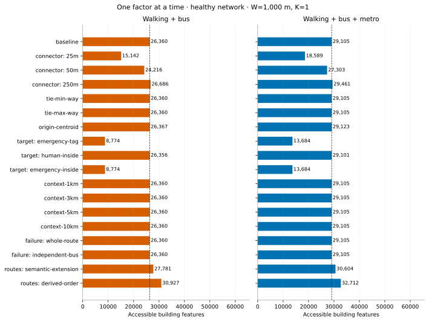

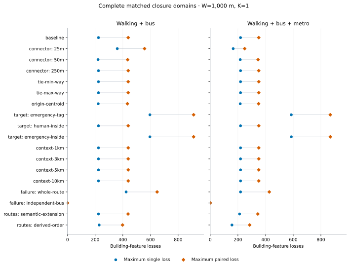

The source-way row uses its own domain and must not be compared to source-segment rows as if the same number of equally sized failures had occurred. The [length-strata table](sensitivity-2026-11-01/length-strata.csv.gz) records every unit in bins [0,25), [25,50), [50,100), [100,250), [250,500), [500,1,000) and [1,000,infinity) metres, with loss distributions for every W/K/mode. These are descriptive length controls, not equal-total-length failure experiments and not evidence that segmentation effects are removed.

### Matched metro-loss comparisons

The following counts compare losses under exactly the same closure, at W=1,000 m, K=1. A higher loss relative to the full-layer healthy baseline does not contradict greater or equal full-layer accessibility after failure. The [complete comparison table](sensitivity-2026-11-01/metro-loss-comparisons.csv.gz) covers every W/K setting; the audit verifies nonnegative absolute post-failure metro benefit in every entry.

| Variant | Single: lower / equal / higher loss with metro | Pair: lower / equal / higher loss with metro |
| --- | --- | --- |
| baseline | 400 / 1,186 / 98 | 570,240 / 702,835 / 144,011 |
| connector-25m | 238 / 1,372 / 74 | 366,467 / 941,281 / 109,338 |
| connector-50m | 381 / 1,205 / 98 | 547,665 / 726,991 / 142,430 |
| connector-250m | 400 / 1,186 / 98 | 570,240 / 702,835 / 144,011 |
| tie-min-way | 400 / 1,186 / 98 | 570,240 / 702,835 / 144,011 |
| tie-max-way | 400 / 1,186 / 98 | 570,240 / 702,835 / 144,011 |
| origin-centroid | 400 / 1,186 / 98 | 568,606 / 702,705 / 145,775 |
| targets-emergency-tag | 466 / 1,171 / 47 | 662,582 / 685,525 / 68,979 |
| targets-human-inside | 400 / 1,186 / 98 | 570,240 / 702,835 / 144,011 |
| targets-emergency-inside | 466 / 1,171 / 47 | 662,582 / 685,525 / 68,979 |
| context-1km | 400 / 1,186 / 98 | 570,240 / 702,835 / 144,011 |
| context-3km | 400 / 1,186 / 98 | 570,240 / 702,835 / 144,011 |
| context-5km | 400 / 1,186 / 98 | 570,240 / 702,835 / 144,011 |
| context-10km | 400 / 1,186 / 98 | 570,240 / 702,835 / 144,011 |
| failure-whole-route | 808 / 667 / 209 | 988,483 / 222,111 / 206,492 |
| failure-independent-bus | 0 / 1,684 / 0 | 0 / 1,417,086 / 0 |
| routes-semantic-extension | 572 / 1,112 / 0 | 801,138 / 615,948 / 0 |
| routes-derived-order | 436 / 1,248 / 0 | 639,685 / 777,401 / 0 |
| whole-osm-way | 73 / 226 / 11 | 19,500 / 25,425 / 2,970 |

## 7. Ranking stability and its limits

Spearman correlation is calculated over every aligned physical single unit or physical pair, using average ranks for ties. The paired vectors contain all 1,417,086 physical pairs in each common-domain comparison. Constant-vector correlations are undefined, rather than forced to zero or one. Added zeros are not extra independent observations and the resulting coefficients are descriptive agreement statistics; no p-values or confidence intervals are calculated.

Two top-set definitions are retained: fractions of the full domain, restricted to positive values; and fractions of the positive subset itself. Both include every cutoff tie. The available positive set can be smaller than the nominal full-domain size. Zero losses/interactions never enter a positive-criticality set. The table below uses the **positive-subset** 5% definition to describe high-loss rank agreement without filling the set with most or all positive units in a zero-heavy domain. Actual set sizes accompany every comparison. Empty-union Jaccard is undefined. The complete output also retains Spearman and sign agreement on the union of nonzero units to expose agreement dominated by shared zeros, as well as top-1/5/10% Jaccards for both definitions, every metric and every W/K/mode.

| Variant | Bus single rho | Full single rho | Bus pair-C rho | Full pair-C rho | Full positive-top-5% single Jaccard |
| --- | --- | --- | --- | --- | --- |
| baseline | 1.000 | 1.000 | 1.000 | 1.000 | 1.000 |
| connector-25m | 0.585 | 0.527 | 0.346 | 0.342 | 0.379 |
| connector-50m | 1.000 | 1.000 | 0.997 | 0.999 | 1.000 |
| connector-250m | 1.000 | 1.000 | 1.000 | 1.000 | 1.000 |
| tie-min-way | 1.000 | 1.000 | 1.000 | 1.000 | 1.000 |
| tie-max-way | 1.000 | 1.000 | 1.000 | 1.000 | 1.000 |
| origin-centroid | 1.000 | 0.990 | 0.968 | 0.961 | 1.000 |
| targets-emergency-tag | 0.559 | 0.468 | 0.412 | 0.350 | 0.011 |
| targets-human-inside | 1.000 | 1.000 | 1.000 | 1.000 | 1.000 |
| targets-emergency-inside | 0.559 | 0.468 | 0.412 | 0.350 | 0.011 |
| context-1km | 1.000 | 1.000 | 1.000 | 1.000 | 1.000 |
| context-3km | 1.000 | 1.000 | 1.000 | 1.000 | 1.000 |
| context-5km | 1.000 | 1.000 | 1.000 | 1.000 | 1.000 |
| context-10km | 1.000 | 1.000 | 1.000 | 1.000 | 1.000 |
| failure-whole-route | 0.555 | 0.544 | 0.390 | 0.334 | 0.096 |
| failure-independent-bus | undefined | undefined | undefined | undefined | 0.000 |
| routes-semantic-extension | 0.982 | 0.944 | 0.942 | 0.818 | 1.000 |
| routes-derived-order | 0.863 | 0.939 | 0.938 | 0.926 | 0.446 |

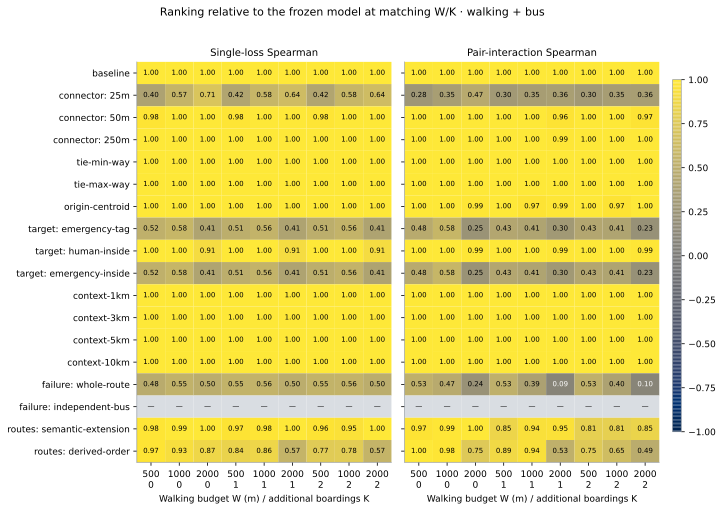

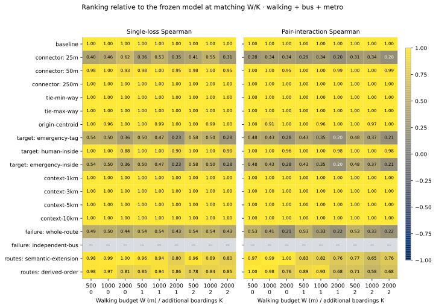

The complete [ranking table](sensitivity-2026-11-01/ranking-stability.csv.gz) also compares all W/K settings within the primary model to W=1,000 m, K=1. Source-way single-loss rankings are compared with the maximum child-segment loss aggregated to those same 310 ways; a source-way rank is never correlated directly with an unaligned 1,684-segment vector.

## 8. Audit scope, reproducibility and publication

The [saved-output census](sensitivity-2026-11-01/sensitivity-audit.json) checks all 19 variants: each physical domain, group membership, feasible group-pair block, failed-set union, pair multiplicity, parameter/mode row, single-loss subtraction, deletion monotonicity, repeated-union agreement and every summary statistic. It verifies artifact hashes and the same ordered origin-ID digest across variants. The independent path replay verifies all requested certificate identities against the complete case-membership registry. No unrecorded sampling or runtime fallback is permitted.

The [execution receipt](sensitivity-2026-11-01/execution.json) retains the verified census start time, final output timestamp, snapshot identity, source-code and configuration identities, every variant-summary hash and the evaluated Python/package versions. It records the Windows execution environment without requiring byte-identical rebuilt SQLite files on every platform.

The complete compilation and full-node comparisons validate the primary model over every failed set. For sensitivity models, the same compiled recurrence is used with new exact walking metrics; the audits check every saved scenario and invariants, while the unit suite checks varied directed/zero-cost graphs and every reconstructed parent chain on those controls. We do not claim a second exhaustive full-node numerical census on all 19 sensitivity networks. Algebraic exactness and tested implementation equivalence should be distinguished from independent recomputation of every alternate-network distance.

The extended local unit suite passes **48 tests**, including complete parent-chain replay on 60 varied small directed/zero-cost controls, compact compilation comparisons, tie-aware ranking/positive-set definitions and the preceding solver/closure tests. Synthetic controls are algorithm tests and never enter the empirical Tehran results.

Reproduce from the extracted public archive and completed primary pipeline, using `requirements-validation.txt`:

| Code | Technical role |
| --- | --- |
| [extract_routes.py](../src/extract_routes.py) | Preserve recorded order by default; expose semantic-extension status selection and explicit geometric-order reconstruction with original member indices. |
| [build_connections.py](../src/build_connections.py) | Build complete split walking chains; optionally record coordinates, choose tied nearest ways, or change origin-point convention. Primary defaults retain their prior numerical meaning. |
| [prepare_sensitivity_models.py](../src/prepare_sensitivity_models.py) | Construct the six required models, run all-way audits, and retain normalized public build receipts and expanded-route stop/order tables. |
| [compiled_compact.py](../src/compiled_compact.py) | Float64 compiled exact walking-metric recurrence; no fastmath or distance approximation. |
| [audit_compact_compilation.py](../src/audit_compact_compilation.py) | Complete primary-domain compilation comparison and all single-loss bitsets. |
| [decompose_interactions.py](../src/decompose_interactions.py) | Exact origin-set inclusion-exclusion for every pair/mode/parameter; deterministic registry of every tied extreme and negative-benefit case. |
| [path_witnesses.py](../src/path_witnesses.py) | Full-node predecessor forests, complete origin requests in registered cases, and replayable edge/boarding/target certificates. |
| [audit_path_witnesses.py](../src/audit_path_witnesses.py) | Independently replay every saved witness; reconcile every case's membership with published losses and check every primary geometric edge/connector. |
| [sensitivity_runs.py](../src/sensitivity_runs.py) | Exact per-variant incidence/signature/union census on the full declared physical domains, with deletion/mode/budget invariants. |
| [audit_sensitivity.py](../src/audit_sensitivity.py) | Enumerate all saved domains/effect rows, reconcile every summary, expand physical-unit/pair comparisons and calculate exact ranking/top-set agreement and length strata. |
| [make_path_figures.py](../src/make_path_figures.py), [make_sensitivity_report.py](../src/make_sensitivity_report.py) | Generate all new vector figures, source manifests, result tables and this English technical record. |
| [verify_sensitivity_evidence.py](../src/verify_sensitivity_evidence.py) | Verify frozen hashes, full variant coverage, all 4,284 packed masks and vector integrity without repeating the long census. |
| [write_sensitivity_execution.py](../src/write_sensitivity_execution.py) | Bind the actually recorded UTC launch time, evaluated engine/environment and every finished variant receipt. |

```bash
python -m research.src.prepare_sensitivity_models
python -m research.src.audit_compact_compilation
python -m research.src.decompose_interactions
python -m research.src.path_witnesses
python -m research.src.audit_path_witnesses
CENSUS_STARTED_UTC=$(python -c "from datetime import datetime,timezone; print(datetime.now(timezone.utc).isoformat())")
python -m research.src.sensitivity_runs
python -m research.src.audit_sensitivity
python -m research.src.write_sensitivity_execution --census-started-utc "$CENSUS_STARTED_UTC"
python -m research.src.make_path_figures
python -m research.src.make_sensitivity_report
python -m research.src.verify_sensitivity_evidence
python -m unittest discover -s tests -v
```

Model/output constructors refuse accidental overwrite. To inventory existing six models after checking their complete audits, use `prepare_sensitivity_models --reuse-verified`. Dated sensitivity output directories are experiment IDs inherited from registration on 1 November; this completion record is dated 2 November. Ignored local logs and temporary runs are not public evidence. Raw generated network databases are reproducible from the public snapshot and configurations and remain ignored. Hash receipts identify the evaluated versions.

The command sequence is for a clean evidence workspace. In a checkout containing the published frozen result folder, preserve that folder before regenerating it; use the final verification command alone to check the distributed evidence. Keep the public frozen outputs available for comparison with any regenerated version. The optional `audit_sensitivity --wait-for-complete` mode waits for each full variant receipt and never substitutes partial rows.

All figures are standalone SVGs with editable text and no embedded raster data. Exact source hashes and SVG hashes are in the [path figure manifest](../figures/sensitivity-2026-11-02/path-manifest.json) and [sensitivity figure manifest](../figures/sensitivity-2026-11-02/sensitivity-manifest.json). Maps use only supplied OSM geometries and reconstructed metric coordinates.

## 9. What can be concluded at this point

### Quantitative synthesis for claim selection

At W=1,000 m, K=1, changing local arc deletion to whole-relation deletion leaves healthy access unchanged but increases the maximum bus-only joint loss from 439 to 648 building features, and the full-layer maximum from 351 to 427. Thus failure semantics matter to reported loss magnitudes. Under the independent-bus mechanism control, every single and pair loss is zero, as required by the construction; this is a verification control rather than an empirical discovery.

Reducing the connector limit to 25 m changes full-layer healthy access from 29,105 to 18,589 building features; increasing it to 250 m yields 29,461. These changes also alter the exposed origin/target/stop sets. The comparison therefore concerns the connector contract as a whole, not only the building snap distance. The full 65,677-feature denominator is fixed throughout.

The semantic-extension model has 30,604 full-layer healthy accessible origins at this setting, compared with 29,105 in the primary model. The separate derived-order hypothesis has 32,712. Neither number establishes which reconstruction matches real operation. Their complete common-exposure loss and ranking comparisons are reported rather than used to select a preferred model after seeing results.

Destination meaning is consequential: under the emergency-tag target subset, full-layer single-loss rank correlation with the primary is 0.468, and positive-subset top-5% Jaccard is 0.011. A single universal priority list would conceal this dependence. This target subset measures recorded tags rather than verified emergency capability.

The negative-DeltaM result is also representation-dependent. The primary has 98 physical single segments with higher loss relative to the full-layer baseline; the derived-order route model has 0 at W=1,000 m, K=1. The certified primary paths establish the mechanism in that observed subnetwork. They do not establish that its prevalence survives every route reconstruction, and the article must retain that distinction.

Across every W/K setting, exact equality of the encoded baseline/single/pair tables holds for: tie-min-way, tie-max-way, context-1km, context-3km, context-5km, context-10km. The check requires identical group, connection and physical-unit indexing, identical complete single/pair effect files and identical result grids, rather than inferring equality from a rounded correlation or a few extrema. Changed outcomes occur for: connector-25m, connector-50m, connector-250m, origin-centroid, targets-emergency-tag, targets-human-inside, targets-emergency-inside, failure-whole-route, failure-independent-bus, routes-semantic-extension, routes-derived-order. Equal outcomes within these selected alternatives are finite-model robustness evidence, not proof of correct entrances, correct routing outside the extract or invariance to all model choices.

| Common-domain variant | Every encoded baseline/single/pair outcome identical to reference |
| --- | --- |
| baseline | True |
| connector-25m | False |
| connector-50m | False |
| connector-250m | False |
| tie-min-way | True |
| tie-max-way | True |
| origin-centroid | False |
| targets-emergency-tag | False |
| targets-human-inside | False |
| targets-emergency-inside | False |
| context-1km | True |
| context-3km | True |
| context-5km | True |
| context-10km | True |
| failure-whole-route | False |
| failure-independent-bus | False |
| routes-semantic-extension | False |
| routes-derived-order | False |

The finite observed model supports exact separation of joint-only losses and shared single losses, and the certified paths explain the negative metro-benefit change as exposure of additional baseline opportunities through a bus last-mile dependency. These mechanisms have concrete inspectable evidence. The 19-variant tables quantify where accessibility, losses and rankings depend on connector, target, route, boundary and failure assumptions. Assumption variation is not real-world uncertainty calibration, and the strongest effects should be reported alongside their actual sensitivity rather than summarized as a universally stable citywide ranking.

The dataset still does not establish complete operating transit service, verified entrances, population weights, emergency capacity, waiting/transfer timing or ambulance response. The primary route eligibility decisions are unchanged. The article should frame its results as a structural dependency study on a screened mapped subnetwork, with OAT sensitivity of the reported quantities. Broad claims about all Tehran passengers or hospitals would exceed this evidence.

## 10. Coverage against the original roadmap

The original roadmap contains broader analyses than the completed closure censuses. A checklist label such as “RQ1 complete” must not be interpreted as completion of every originally proposed benchmark. The current coverage is:

| Roadmap item | Actual status |
| --- | --- |
| Frozen data, route eligibility, walking graph, connectors and dependency construction | Complete within the declared mapped-data/geometric contract; real-world completeness is not certified. |
| Primary solver and preservation controls | Complete full-domain controls, documented in the preceding validation record. |
| Healthy access, every single closure and every pair in the registered primary domain | Complete for all W/K settings and both mode sets. |
| Primary pair-set mechanisms, selected-case path explanations and metro/ranking sensitivity | Complete on the explicitly registered case and OAT domains in this report. |
| Connector/target/context/failure/route OAT variants and source-way aggregation | All 19 registered variants complete; not a Cartesian product of assumptions or an equal-length-budget experiment. |
| Road-class, number-of-dependent-routes and weighted street-betweenness comparisons | Not executed. The original RQ1 comparative-benchmark clause remains open; exhaustive closure evaluation alone does not complete it. |
| Remaining network/component/route-overlap summaries, district-level loss/coverage summaries and number of reachable target groups | Not completed as the full descriptive suite originally proposed. Existing baseline/coverage figures do not substitute for those outputs. |
| Distance/shared-route correlates of pair interaction | Not executed as a separate association analysis. Exact interaction counts and case mechanisms are complete. |
| Riding-length diagnostics | Complete for every successful registered-case witness; not an all-city itinerary census or a riding-cap sensitivity experiment. |
| Combined-assumption sensitivity, equal-length failure budgets and larger multi-segment stress curves | Not executed. These are distinct extensions; the present OAT and length strata do not claim to replace them. |
| Conference claim/figure selection, literature comparison, manuscript and submission review | Pending. The SVGs here are inspectable research evidence, not a finalized conference layout. |

**Next stage:** complete or explicitly scope the still-open structural benchmarks and descriptive outputs before freezing the manuscript's claims; then consolidate conference figures and write/review the paper. The optional larger-failure/combined-assumption extensions require their own declared domains. This record completes path explanation and registered OAT/ranking analysis, without silently marking the broader roadmap as finished.
