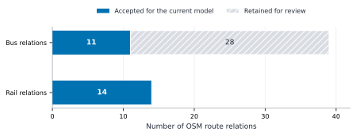
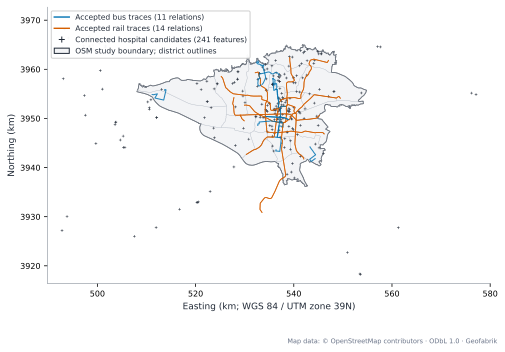
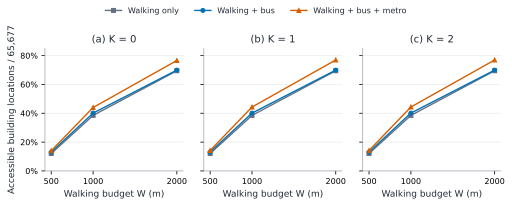
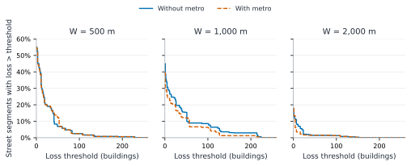
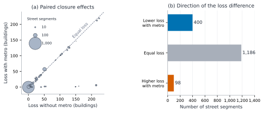

# Street–route dependencies and structural healthcare accessibility in Tehran

## Methods and results completed through the single-closure stage

**Evidence cutoff:** 1 November 2026. **Map snapshot:** 29 October 2026, 21:21:26 UTC.  
**Primary dataset:** `tehran-osm-20261029T212126Z-v1.1-public`.  
**Status:** a cumulative technical report and a basis for manuscript writing. Pair interactions, sensitivity analyses, and a literature-based novelty assessment are not completed results.

## Abstract

We developed a static multilayer model to study how dependencies between street segments and bus connections affect structural access from mapped building locations to hospital candidates in Tehran. The model uses a single OpenStreetMap snapshot and combines an undirected walking graph, directed bus and rail connections, and explicit dependencies between consecutive bus stops and the street segments supporting their recorded traces. It measures whether a building location can reach a target within a cumulative walking budget and a bounded number of boardings. It does not estimate travel time or emergency response. After an additional stop-order audit, the current model includes 11 bus relations and 14 rail relations. We computed intact-network accessibility and all single closures of the 1,684 observed street segments supporting those bus connections. At a 1,000 m walking budget and at most two boardings, 26,360 building locations were accessible without metro and 29,105 with metro. Single closures caused positive losses for 757 and 667 street segments, respectively. The largest losses were 224 and 219 building locations. For 98 segments, the absolute loss was larger in the model with metro, although accessibility with metro remained at least as high in every matched scenario. These are results for the screened map-based model, not estimates of complete operating-service coverage. The implementation, input identities, audit outputs, exact scenario mapping, and vector figures are recorded for reproducibility.

## 1. Research question and scope

A street segment can support several bus connections. Its closure can therefore remove more than a local road link: it can remove opportunities to ride between stops and change access through the wider transport network. The relevant complex-network structure is a multilayer graph with an explicit, asymmetric dependency from bus connections to street segments.

Our question is: **which observed street segments support structurally important bus connections for access to mapped hospital candidates, and how does the presence of metro change the size and distribution of accessibility losses?** This can inform the identification of locations for closer service-continuity review. The current evidence does not support an operational closure plan, a population-based equity ranking, or a prediction of emergency response.

The present experiment isolates one mechanism: street closure disables dependent bus connections while the walking graph and metro remain fixed. A physically impassable pedestrian barrier, a flooded district, a capacity failure, or a rerouted bus would require a different scenario definition. The observed failure mechanism is one-way dependency propagation; we do not claim a feedback cascade or a phase transition.

Only the frozen public dataset supplies records to the analytical model. No API output, new map source, inferred timetable, synthetic passenger demand, or external hospital validation was added for the reported experiments.

## 2. Data provenance and the study boundary

### 2.1 From the initial extraction to the frozen public dataset

An initial BBBike rectangular extract motivated the preparation work, but the final raw context PBF was rebuilt from one Geofabrik Iran snapshot. We did not merge different OSM vintages to fill the final raw file. During preparation, missing references and relevant parent relations were recovered from the same national snapshot. The construction record also documents the explicit inclusion of Tehran line 5 records, which use `route=train` rather than `route=subway` in OSM.

The final context rectangle is `[50.9, 35.4, 51.95, 36.05]` in west, south, east, north order. Ways and referenced objects were retained to preserve network structure; the rectangle is not the research city boundary and is not a claim of exact geometric clipping of all features. The context PBF contains 2,081,117 nodes, 365,896 ways, and 4,016 relations. The archived integrity audit found no missing way-node references or relation members and no duplicate IDs. Referential completeness does not establish that every real street or operating service has been mapped.

The public distribution retains OSM-derived records. A historical IranTracking database dated 14 May 2024 was inspected locally after it was identified through Alireza Ahani's API article. It is neither an input to the primary model nor republished, because an explicit redistribution license was not established. Historical comparison layers, record-level crosswalks, and external hospital website-evidence fields were removed from the public release. Google Maps, Neshan, Map.ir, and Balad output is not included. Sources that were reviewed are not automatically sources of model records.

### 2.2 Operational definition of Tehran

The origin mask is OSM city relation **6663864**, associated with 22 municipal districts in the same snapshot. It represents the study's operational definition of Tehran city, rather than Tehran Province, Tehran County, the metropolitan area, or a rectangular cutout. Its legal equivalence to the latest officially approved municipal boundary has not been independently verified.

The archived boundary audit reports a valid, single-part MultiPolygon with closed rings and no holes. All 4,038 boundary-node references were present. Projected area is 630.249354 km² in EPSG:32639; geodesic WGS 84 area is 630.734212 km². These are different measurement methods, not contradictory estimates. The 22 district geometries are valid. Their union leaves approximately 0.063688 km² of the city uncovered, with no area outside the city and only numerical-scale overlap. This small discrepancy was retained, and 24 buildings without a unique district assignment were not forced into a district.

The context geometrically covers city buffers through 10 km. That check does not establish that the context is sufficient for every possible detour or closure. Context-size convergence remains a sensitivity question.

### 2.3 Feature membership and geometry

Buildings are retained when more than half of their footprint area lies inside the city polygon. A numerical tie at one half is resolved using whether the city covers the representative point. Each retained building supplies one equal-weight origin location. These locations are proxies for spatial opportunities, not observed residents, trips, or demand. The analytical origin uses the point stored during preparation; it is not a verified building entrance.

Network geometry is not clipped at the city boundary. Walking and transit paths may leave the city and return. Hospital candidates outside the city can be destinations if they are present and connected in the context. This avoids treating the municipal line as a movement barrier. It does not prove that every plausible external destination is included.

Coordinates are stored in EPSG:4326. Distance calculations, route projections, connector lengths, and figures use WGS 84 / UTM zone 39N, EPSG:32639.

## 3. Data inventory and the analytical subset

### 3.1 Public spatial layers

| Layer | Records | Role |
|---|---:|---|
| `city_boundary` | 1 | Building-origin mask |
| `municipal_districts` | 22 | Administrative labels and boundary diagnostics |
| `roads_context` | 218,322 | Source road ways and their stored attributes |
| `buildings_city` | 65,677 | Equal-weight origin locations |
| `hospital_candidates` | 321 | Raw mapped hospital candidates |
| `hospital_screened_candidates` | 321 | Screening decisions for the same raw candidates |
| `transit_active_member_geometry` | 361 | Source transit-member geometry |
| `transit_gap_diagnostics` | 427 | Geometry and continuity diagnostics |

Layer records, OSM ways, graph edges, route relations, and physical services are different units. For example, 218,322 road ways is not the size of the final walking-edge set, and 14 rail relations is not a claim that Tehran has 14 metro lines. The public archive also contains route inventories, ordered-path outputs, road membership, restriction audits, and exception registries. Stored turn-restriction data have not become a turn-aware car-routing model.

### 3.2 Route and stop-order screening

An earlier strict path screen admitted 39 bus and 14 rail relations. We then reconstructed stop associations in recorded OSM member order and projected them onto each oriented trace. At least two stop-position members are preferred; otherwise the platform representation is used. A way platform is represented by its geometric midpoint. This is a representation rule, not entrance validation.

Projection checks use a 100 m stop-to-trace limit, a 1 m projection-distance tolerance, a 20 m separation criterion for ambiguous progress locations, and a 1 m order tolerance. Repeated trace locations can be ambiguous even if the nearest geometric distance is small. Stops were not silently sorted by projected distance or reversed to make a relation pass.

Of the 39 bus relations, **11** were accepted for the current connection model and **28** were retained for review: 27 had mixed progress order and one opposed the selected trace orientation. One flagged relation also exceeded the stop-to-trace distance limit. These flags overlap. All 14 rail relations passed this additional diagnostic. Conflicting order can reflect OSM member conventions, paired platforms, or the selected trace orientation; the audit does not establish that all excluded relations are wrong.

Across the 53 input relations, 948 stop associations were selected. The accepted subset contains **443 stop occurrences** and **418 directed consecutive-stop connections**, comprising 138 bus and 280 rail connections. An occurrence belongs to a route and position in its sequence; it is not necessarily a distinct physical station. Stop-area reconciliation remains incomplete.



**Figure 1.** Additional route screening within the initially strict subset. Hatching marks relations retained for review. Counts describe OSM relations and do not measure operating-service completeness. [SVG](../figures/progress-2026-11-01/01-route-screening.svg).

### 3.3 Hospital candidates

The raw hospital screen contains 321 features. Tag-based screening retains 249 human-hospital candidate features in 244 possible groups. After the geometric connector test, **241 features in 236 possible groups** are connected; eight features exceed the connector-distance limit. Group labels record possible duplicate institutions, not independently verified hospital identities. The solver treats connected target features as alternative destinations; several features can belong to one possible group.

The current target set is broader than the earlier emergency-tag subset discussed during preparation. Results in this report use the configured `human_hospital_candidate` set. We do not call these verified emergency departments, assume 24-hour admission, or use their number as a clinical-capacity measure.



**Figure 2.** Recorded traces of the accepted 11 bus and 14 rail relations, the OSM city and district boundaries, and the 241 connected hospital candidate features. Full accepted traces are displayed, including portions outside the city; the figure is not a density or service-coverage map. The 930,852 walking edges and individual building origins are omitted for legibility. Hospital symbols are representative feature locations, not entrances. Map data: © OpenStreetMap contributors, ODbL 1.0; distributed by Geofabrik. [SVG](../figures/progress-2026-11-01/02-study-network-map.svg).

## 4. Multilayer graph construction

### 4.1 Walking graph

We selected 206,474 source ways carrying the stored `walk_candidate` flag. Consecutive OSM nodes supply undirected walking adjacency with projected length as edge cost. Original OSM node identity is retained: geometric crossings without a shared OSM node do not create an intersection. Connectors inserted along a source segment split it without changing its total length. Distinct source node IDs are not merged solely because their coordinates coincide.

The resulting graph has **848,604 nodes** and **930,852 stored undirected edges**. The solver creates both adjacency directions for each stored edge. This walking topology follows the dataset's eligibility policy; the implementation does not independently certify pavement access, barriers, gates, or pedestrian permissions at every location.

### 4.2 Geometric origin, stop, and target connectors

Each entity is projected to its nearest candidate walking way. An offset of at most **100 m** is accepted. The projected position becomes a walking anchor, and the straight offset is charged as walking distance. The same threshold is used as a declared initial convention for all entity types; it is not a calibrated access standard.

| Entity | Accepted connectors | Beyond 100 m | Total considered |
|---|---:|---:|---:|
| Building locations | 64,166 | 1,511 | 65,677 |
| Human-hospital candidate features | 241 | 8 | 249 |
| Accepted stop occurrences | 443 | 0 | 443 |

An equal-distance nearest-way tie currently selects one STRtree result. Alternative tied connections, entrance placement, and the 100 m threshold require sensitivity analysis. We retain the 1,511 rejected buildings in the full denominator with no eligible model path; we do not silently remove them or interpret their rejection as real-world isolation.

### 4.3 Transit layers and boarding roles

A transit connection is a directed arc between consecutive stop occurrences on a recorded trace. Riding along it adds no **walking** cost; this does not mean that the ride takes no time. A traveler can remain on board through a stop without alighting. A stop without accepted walking access may still be passed while on board.

OSM entry-only and exit-only roles restrict boarding and alighting. Sixteen stop associations carry such restrictions. Stops of a disabled mode lose both their riding arcs and boarding/alighting permissions. Off-vehicle transfers always use walking paths and the relevant connector lengths. There is no free reset of a traveler onto another route.

### 4.4 Street-to-bus dependencies

For each directed consecutive-stop bus connection, we identify source segments with positive overlap along its trace interval. A street unit is stored as `w<way_id>:n<smaller_node_id>:n<larger_node_id>`. Keeping the way ID avoids merging separate source ways or carriageways merely because they use the same node pair. The unit is an OSM adjacent-node segment, not a named street or a physically aggregated corridor.

An endpoint touch alone does not create a dependency. Positive overlaps sum to the connection's recorded trace length. The model contains **1,895 dependency occurrences** across **1,684 distinct source street segments**. A connection depends on every supporting segment; a single segment may support several connections. These sets can be read as street supports of transit connections. The implementation uses explicit dependency incidence rather than a separate hypergraph solver.

For a closed street set F, each bus connection whose support intersects F is disabled. Other bus connections remain usable. We do not delete a whole relation when only one local connection fails, and we do not create a replacement route. Metro and walking remain fixed in the main experiment. Whole-route deletion and other failure policies remain sensitivity analyses.

## 5. Accessibility definition and exact solver

### 5.1 Measured quantity

Let B be the fixed set of 65,677 building locations and H the connected hospital target features. For each building, we seek the minimum total walking distance of an eligible path to any target, subject to a boarding budget. Walking includes the building connector, all walking-network edges, every boarding/alighting connector used, transfers, and the final hospital connector.

The stored configuration calls K `max_line_changes`. Its implemented meaning is a conservative budget of **at most K + 1 boardings**. Reboarding the same relation consumes another boarding. It is therefore an additional-boarding convention, rather than a detailed operational interchange model. Walking-only paths remain eligible under every transit budget.

We evaluate W in {500, 1,000, 2,000} m and K in {0, 1, 2}. If d(i,F,K) is the minimum cumulative walking distance under the scenario, define:

```math
N(F;W,K)=\sum_{i\in B}\mathbf{1}\{d(i,F,K)\leq W\},
\qquad A(F;W,K)=N(F;W,K)/|B|.
```

Every building has weight one. The optional connected-origin denominator is 64,166, but full-denominator shares use 65,677 throughout the principal comparison. Destinations can lie outside the city, as described above. We estimate structural accessibility within these constraints, not trip utility, observed mode choice, or a travel-time threshold.

### 5.2 Reverse dynamic programming

The algorithm first runs a reverse multi-source walking Dijkstra from hospital anchors, seeded with their access lengths. This gives the zero-boarding vector D0. For each subsequent boarding budget b, it:

1. Seeds alight-allowed stop occurrences with their connector cost plus D(b−1) at the walking anchor.
2. Propagates the minimum value backward through directed riding arcs at zero additional walking cost, including onboard passage through restricted stops.
3. Seeds board-allowed walking anchors with the onboard value plus the boarding connector cost.
4. Runs incremental walking Dijkstra while retaining D(b−1), producing an **at-most-b** rather than exactly-b result.

Building access lengths are added when evaluating origins. Transit direction is preserved by reverse traversal of the original directed arcs. The search cutoff is the largest W, 2,000 m. An infinite or blank cost means that no eligible path was found within that walking cutoff; it does not prove global disconnection at all distances.

The walking graph and the zero-boarding vector are reused across closure scenarios. The implementation uses nonnegative walking costs and explicitly validates them. No route speed, vehicle travel time, waiting time, transfer schedule, capacity, or congestion model is introduced.

## 6. Intact-network results

The table reports accessible **building locations**, with a fixed denominator of 65,677. Walking-only values repeat across K because the boarding budget has no effect on walking-only paths. All parameter combinations are shown; K=1 is used for some figures only to make the comparison readable.

<!-- BEGIN BASELINE_TABLE -->
| K | W (m) | Walking only | Walking + bus | Walking + bus + metro |
| --- | --- | --- | --- | --- |
| 0 | 500 | 7,944 | 8,566 | 9,213 |
| 0 | 1,000 | 25,295 | 26,356 | 28,886 |
| 0 | 2,000 | 45,634 | 45,921 | 50,296 |
| 1 | 500 | 7,944 | 8,595 | 9,321 |
| 1 | 1,000 | 25,295 | 26,360 | 29,105 |
| 1 | 2,000 | 45,634 | 45,921 | 50,539 |
| 2 | 500 | 7,944 | 8,595 | 9,323 |
| 2 | 1,000 | 25,295 | 26,360 | 29,115 |
| 2 | 2,000 | 45,634 | 45,921 | 50,539 |
<!-- END BASELINE_TABLE -->



**Figure 3.** Fraction of all 65,677 building locations that can reach a connected target in the intact model. Panels correspond to K=0, 1, and 2 additional-boardings budgets. W is cumulative walking, not distance to the nearest station. Lines connect the three evaluated budgets as visual guides and do not establish a continuous response curve. Adding a mode cannot remove an eligible path, so nonnegative accessibility gains are a model property; their magnitudes are the measured result. [SVG](../figures/progress-2026-11-01/03-intact-accessibility.svg).

At W=1,000 m and K=1, walking alone reaches 25,295 building locations, walking plus bus reaches 26,360, and the model including metro reaches 29,105. These counts show opportunities under the chosen constraints. The bus increment must be interpreted in the context of only 11 retained bus relations; it is not an estimate of the contribution of all buses in Tehran. The current results also depend strongly on W, which makes walking-budget sensitivity a substantive part of the study.

## 7. Exhaustive single-closure experiment

### 7.1 Scenario enumeration and exact grouping

We tested every observed source street segment supporting an accepted bus connection, for **1,684 single-closure scenarios**. The experiment does not enumerate all 218,322 road ways or all streets of Tehran. Street segments with identical sets of dependent connection IDs create exactly the same failed transit graph. There are **238 distinct dependency signatures**, which were solved once each and mapped back to all street units. This is exact grouping, not sampling or an approximation.

Each signature was evaluated for the full nine-point W/K grid in both mode sets: walking plus bus, and walking plus bus plus metro. The saved effect table therefore has **2,142 rows**, each containing both mode results. The separate street table restores the per-street unit. Aggregate summaries weight a signature by its number of street segments. Treating all 238 signatures as equally frequent would answer a different question.

For one street e, loss in count units is `L_N(e) = N(empty) − N({e})`; the share-based criticality is `I(e) = L_N(e) / 65,677`. These are relative to each mode set's own intact baseline. A zero loss can reflect an available alternative, the walking budget, the selected targets, or absence of relevant dependence for currently accessible origins. It does not certify that a street is unimportant outside this model.

### 7.2 Results for the full parameter grid

Positive-loss street counts and maximum losses are shown below. Maximum loss is measured in building locations. The largest losses in two mode sets need not refer to the same street, so those columns alone are not a paired metro comparison.

<!-- BEGIN CLOSURE_TABLE -->
| K | W (m) | Positive-loss streets: bus | Positive-loss streets: bus + metro | Maximum loss: bus | Maximum loss: bus + metro |
| --- | --- | --- | --- | --- | --- |
| 0 | 500 | 879 | 879 | 232 | 230 |
| 0 | 1,000 | 735 | 604 | 224 | 219 |
| 0 | 2,000 | 301 | 201 | 153 | 153 |
| 1 | 500 | 929 | 924 | 251 | 249 |
| 1 | 1,000 | 757 | 667 | 224 | 219 |
| 1 | 2,000 | 301 | 299 | 153 | 153 |
| 2 | 500 | 929 | 924 | 251 | 249 |
| 2 | 1,000 | 757 | 667 | 224 | 219 |
| 2 | 2,000 | 301 | 299 | 153 | 153 |
<!-- END CLOSURE_TABLE -->



**Figure 4.** Exact empirical survival distributions of absolute building-location loss at K=1. Each of the 1,684 street segments has weight one, including zero-loss segments. The vertical axis is the percentage with loss **strictly greater** than the horizontal threshold. At zero, it therefore equals the positive-loss fraction. The distributions are descriptive; no random failure probability or statistical confidence interval is implied. [SVG](../figures/progress-2026-11-01/04-single-closure-loss-distribution.svg).

At W=1,000 m and K=1, positive losses occur for 757 segments without metro and 667 with metro. The maximum losses are 224 and 219 building locations. The mean loss over all observed street segments is 20.76 without metro and 15.31 with metro. This equal-segment average is sensitive to OSM segmentation and is not an expected real-world loss unless a corresponding failure distribution is justified. The largest full-model single loss in this setting is approximately 0.333 percentage points of all building locations; it is not a percentage of residents.

## 8. What metro changes, and what it does not prove

For a fixed scenario, define metro benefit in count units as `M_N(F) = N_bus+metro(F) − N_bus(F)`. Because the complete model contains the bus model's eligible paths, M_N(F) cannot be negative. This is a monotonicity property of the construction, not an empirical discovery about reliability.

The change in benefit after a closure is different:

```math
\Delta M_N(e)=M_N(\{e\})-M_N(\varnothing)
             =L_{N,\mathrm{bus}}(e)-L_{N,\mathrm{bus+metro}}(e).
```

This difference can have either sign. At W=1,000 m and K=1, the loss is lower with metro for **400 segments**, equal for **1,186**, and higher for **98**. The last set comprises seven dependency signatures; its difference is −6 or −7 building locations. Full-model accessibility nevertheless remains at least as high for every matched closure. A network with more opportunities can expose some of its extra opportunities to the failed bus support.



**Figure 5.** Paired effects at W=1,000 m and K=1. In panel (a), each marker aggregates street segments with the same pair of absolute losses; marker area is proportional to their count. The dashed line marks equal loss. Points above it indicate larger absolute loss in the full model, rather than lower absolute accessibility than the bus model. Panel (b) restores the full 1,684-segment count by the sign of the paired difference. This figure does not imply independent observations: many segments share a dependency signature. [SVG](../figures/progress-2026-11-01/05-metro-loss-comparison.svg).

These results motivate a path-level examination of the seven negative-difference signatures. We have not yet identified and validated their detailed geographic mechanisms. Likewise, we have not shown that metro reduces losses under every failure set, that it provides operational backup, or that it improves a population-weighted outcome.

## 9. Validation completed so far

We separate file integrity, model implementation checks, and real-world validity. Passing the first two does not establish the third.

| Check | Evidence and scope |
|---|---|
| Frozen artifacts | Public release/manifest checksums, archive verification, SQLite checks and layer counts |
| Source completeness | Archived audit: no duplicate IDs or missing PBF references; complete boundary references |
| Boundary geometry | Valid city/district geometries, recorded area discrepancy, no forced district assignment |
| Route projection and order | Tests for repeated-location ambiguity, reverse/mixed order, segment boundaries and zero-length geometry |
| Walking construction | No dangling accepted anchors; nonnegative costs; 20 sampled original way lengths agree with their split-edge sums |
| Bus incidence | Dependency overlaps sum to each connection interval; no orphan or non-bus dependency records |
| Boarding semantics | Direction, cumulative access costs, entry/exit permissions, through-riding, and additional-boardings budget tests |
| Independent solver reference | 720 exact comparisons with forward expanded-state search: 30 deterministic random small graphs × four boarding budgets × six origins |
| Closure implementation | Grouped versus individual deletions; independent forward-search examples; unaffected local arcs retained |
| Whole-scenario invariants | For all tested signatures and budgets, deletion never improves any node's cost; added metro and a larger boarding budget never worsen it |
| Baseline regression | Shared loader reproduces published M3 counts with matching network/configuration hashes |
| Saved closure outputs | All 1,684 source segments, 238 groups, 2,142 effect rows, memberships, hashes, losses, shares and weighted summaries reconciled against SQLite |

The current suite contains **27 passing unit tests**. The independent closure examples add 27 forward-search comparisons beyond the 720 baseline comparisons. The stored graph-length comparison is a sample of 20 source ways, not a full geometric survey. Nodewise invariants are necessary implementation checks; they would not detect every possible modeling or data error.

The figure generator reads saved evidence directly, emits editable-text vector SVGs, and records source/output SHA-256 values in a figure manifest. Canonical LF line endings keep published artifact hashes stable across checkouts. All five figure layouts were reviewed through rendered PNG previews, and a legend/annotation collision was corrected. SVG structure was checked for editable text and the absence of embedded raster images. Report links and output hashes were also checked. These presentation checks are separate from arithmetic validation.

## 10. Implementation record

| Module or artifact | Technical responsibility |
|---|---|
| [`scripts/verify_dataset.py`](../../scripts/verify_dataset.py) | Verify archive parts, reconstruct the ZIP, and check/extract the frozen public data |
| [`scripts/build_public_dataset.py`](../../scripts/build_public_dataset.py) | Public-distribution allowlist, removal of excluded material, SQLite rebuild and manifests |
| [`extract_routes.py`](../src/extract_routes.py) | Reconstruct oriented traces and stop associations; audit projection and recorded order |
| [`build_connections.py`](../src/build_connections.py) | Build walking edges, geometric connectors, directed transit connections and street dependencies |
| [`audit_connections.py`](../src/audit_connections.py) | Check stored graph integrity, interval sums, roles and sampled length preservation |
| [`accessibility.py`](../src/accessibility.py) | Shared graph loader and exact reverse boarding-budget dynamic program |
| [`single_closures.py`](../src/single_closures.py) | Enumerate dependency signatures, remove affected arcs and compute the full single-closure grid |
| [`audit_closures.py`](../src/audit_closures.py) | Reconcile stored scenario effects, per-street mappings and aggregates |
| [`make_progress_figures.py`](../src/make_progress_figures.py) | Generate this report's SVGs, exact data tables, figure data and checksum manifest |
| [`tests/`](../../tests/) | Small graph examples and independent solver checks |
| [`baseline.json`](../config/baseline.json) | Frozen initial parameter choices and dataset identity |
| [`verify.yml`](../../.github/workflows/verify.yml) | Automated reconstruction and verification sequence |

Python handles graph construction and algorithms. Pyosmium reads OSM structures; Shapely and STRtree handle geometry and nearest-way queries; pyproj supplies the metric projection; SQLite stores the model; NumPy supports distance vectors; Matplotlib exports the figures. Exact declared dependencies are in [`requirements-research.txt`](../../requirements-research.txt). We do not claim results from a deployed transport-routing service.

The SQLite model contains `walk_edges`, `connectors`, `transit_connections`, `bus_dependencies`, and metadata. The ignored model directory stores M1 routes, stops, connections and metric traces. Experiment outputs are written to distinct run directories that refuse overwrite. Small frozen summaries and the single-closure tables are tracked publicly; generated large models and per-building baseline costs are reproducible local outputs.

## 11. Reproduction and evidence links

Starting from a clean clone with Python 3.11 or later:

```bash
python scripts/verify_dataset.py --extract
python -m pip install -r requirements-research.txt
python -m unittest discover -s tests -v
python -m research.src.extract_routes
python -m research.src.build_connections
python -m research.src.audit_connections
python -m research.src.accessibility
python -m research.src.single_closures --baseline research/runs/m3-baseline-v1/summary.json
python -m research.src.audit_closures --directory research/runs/m3-single-closures-v1
python -m research.src.make_progress_figures
```

Extraction and model/run commands refuse existing destinations; on an already prepared workspace, reuse verified inputs or provide a new supported output directory. The closure command checks that its reference baseline matches its model and configuration. Its default reference is the published baseline; the explicit option above uses the newly rebuilt one. Figure generation overwrites only its named report figures, preview images, figure metadata and marked numeric-table blocks in this report. It does not rerun experiments or change scenario results.

The supported model pipeline starts from the bundled public artifact. The original national snapshot is not bundled, and historical construction scripts used local staging paths. They preserve a technical preparation record rather than a portable one-command recreation of the entire national-to-public preparation history.

Primary evidence:

- [Dataset contents](../../data/README.md), [release identity](../../data/release.json), [manifest](../../data/manifest.json), and [provenance](../../docs/provenance.md).
- [Detailed construction record, Persian](../../docs/dataset-construction.fa.md), [archived local audit](../../docs/audits/local-v1.1-audit.json), and [research protocol, Persian](../../docs/research-protocol.fa.md). The local audit includes excluded mixed-source preparation history; its archive hash is not the public-release hash.
- [M1 summary](m1-2026-11-01-summary.json), [route audit](m1-2026-11-01-routes.csv), [M2 summary](m2-2026-11-01-summary.json), and [M2 audit](m2-2026-11-01-audit.json).
- [M3 baseline](m3-2026-11-01-summary.json) and [single-closure summary](m3-single-closures-2026-11-01/summary.json).
- [Effects by signature](m3-single-closures-2026-11-01/effects.csv), [street-to-signature mapping](m3-single-closures-2026-11-01/streets.csv), and [failed-connection membership](m3-single-closures-2026-11-01/groups.json). Join effects and streets on `signature` to obtain per-street results.
- [Figure input/output hashes](../figures/progress-2026-11-01/manifest.json) and [numeric figure data](../figures/progress-2026-11-01/figure-data.json).

| Identity | SHA-256 |
|---|---|
| Context PBF | `f49737cb2ba86b783fc2b58ceda1534ae9e19bb24b678426d537dea3f742d7f5` |
| Public ZIP | `aed6ffea980feaa563f00e2f42771947beb3a1258b9e6268715eb16b5013996c` |
| Local M2 network | `465b10f73cc00d655fffe1fbfca50a177296c74820a397a93baad0732e278e06` |
| Initial configuration | `7b8caa982d84ec9b53acd1d80beb64d7fc5bc1f5accb661ea9608050c48b7fe1` |

Original project code and documentation use MIT. OSM records and derived databases retain ODbL obligations and attribution to OpenStreetMap contributors. MIT does not relicense the underlying database. The figure manifest identifies evidence files; timestamps and local SQLite bytes are not a promise that all rebuilt artifacts are byte-identical on every platform.

## 12. Current limits and claims we can support

The supported conclusion is that the implemented street-to-bus dependency mechanism creates a nonuniform distribution of accessibility losses in the screened static network. Metro changes both baseline opportunities and the losses under matched single closures. The computed sizes, sign patterns and their dependence on W/K are empirical properties of this model and snapshot.

The following issues remain material:

1. **Mapped coverage and selection.** Only 11 of the 39 initially strict bus relations enter the present model. The route-order exclusions can produce selection bias; small effects cannot be generalized to the full bus system. A relation passing an audit is not certified to operate on the snapshot date.
2. **Origin and target meaning.** Buildings have equal weights and incomplete stock coverage is possible. Targets are tag-screened hospital candidates with possible duplicates, not validated emergency services. No population, demand, passenger count, or capacity is available.
3. **Geometric access.** Straight nearest-way offsets, unverified entrances and barriers, nearest-way ties, walking eligibility and incomplete stop-area reconciliation can alter accessibility. The 100 m convention needs testing.
4. **Service constraints.** There are no timetables, waiting times, vehicle speeds, transfer synchronization, or operational validation. Budgeted structural paths can contain long rides. Additional boardings are deliberately counted conservatively.
5. **Failure definition.** Closures affect dependent bus arcs only; pedestrians and metro are fixed. No rerouting, capacity redistribution or car-routing restrictions are simulated. Source segmentation and separate carriageways affect the scenario unit.
6. **Boundaries.** OSM is the operational city mask, not a verified legal boundary. External destinations are permitted within the available context, whose routing sufficiency has not been established by convergence tests.
7. **Inference and novelty.** These are exhaustive deterministic results within a finite observed single-closure domain, not a random sample of independent real failures. We have not fit a power law, estimated a failure probability, established a threshold transition, or completed the literature work needed to claim methodological novelty.

Sensitivity and interpretation are still required before using these numbers as the final evidence of a conference paper. The current implementation checks justify proceeding to the next analysis stage within the stated model; they do not guarantee a perfect dataset.

## 13. Next step: paired closures and interaction

The immediate next question is whether two street closures together produce more or less loss than the sum of their separate losses. With A defined as the full-denominator accessibility share, the planned interaction is:

```math
C(e,f)=L_A(\{e,f\})-L_A(\{e\})-L_A(\{f\}),
\quad L_A(F)=A(\varnothing)-A(F).
```

Positive C denotes a joint loss larger than the sum of single losses; negative C denotes overlap or subadditivity. It is not, by itself, evidence of a dynamic feedback cascade. The two-mode comparison must use the same street pair, origin/target sets and W/K values.

Before executing that stage, we will record a pair-selection protocol and compute its exact domain size. There are 1,417,086 unordered distinct street pairs. Different pairs can have the same union of failed bus-connection IDs; those unions can again be evaluated once. Their interaction still uses the corresponding two single losses, so union grouping must not erase pair identity or multiplicity. Distinct street segments with the same single-failure signature are valid pairs and should not disappear from the analysis.

The next deliverable should contain:

- A declared exhaustive or sampled pair domain, its rationale, and a fixed seed if sampling is needed. Compute the number of distinct failed-connection unions and benchmark runtime before choosing scope; do not choose pairs after looking for large interaction scores.
- Tests for union-based failure propagation, grouped-versus-individual equivalence, and positive/zero/negative interaction on small independently solvable examples.
- Matched two-mode interaction results over the declared W/K grid, with complete pair multiplicities and clear denominators.
- A first geographic/path-level explanation of selected interaction cases and of the seven single-closure signatures with negative DeltaM.

After paired closures, the necessary validation work is connector/budget sensitivity, alternative failure-policy checks, context and target-set checks where supported by the same dataset, and ranking stability. Only then should we fix the manuscript's strongest claims and select final figures. This report records completed work separately from that plan.
