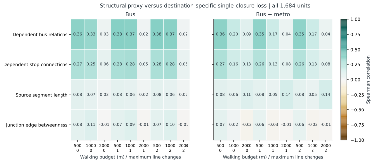
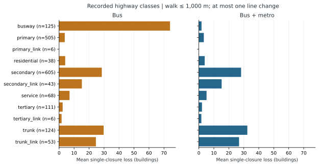
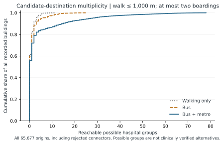
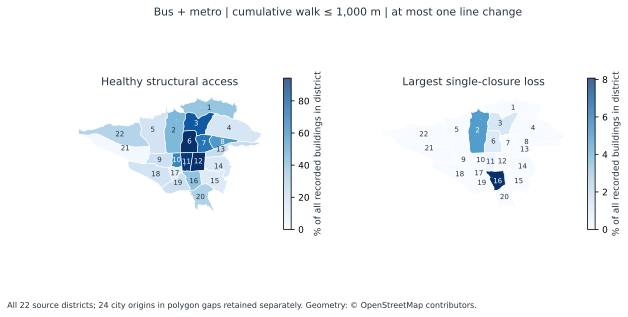
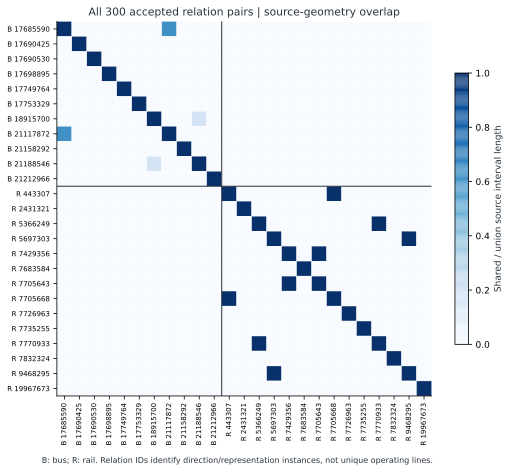
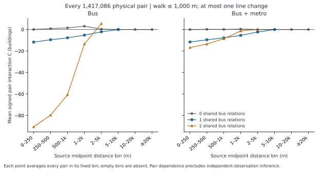

# Complete structural comparisons and spatial descriptions

This stage adds structural comparators and descriptions to the existing exhaustive single- and paired-closure experiments. The baseline dataset, accepted transit relations, connector policy and primary closure results are unchanged. Every calculation below uses the frozen public OSM-derived dataset. No operational transport, population or clinical records were added.

The analytical domain is the observed network, not a claim that all Tehran services are mapped. The principal outcome remains feasibility of a modeled path to a mapped human-healthcare candidate under a cumulative walking budget and a maximum number of boardings. Buildings have equal feature weight; a group is a possible institution, not a certified independent treatment alternative.

Riding arcs add zero to the cumulative walking-cost label; this label is not total travel distance or time. The primary failure disables dependent bus stop-to-stop arcs and keeps walking and rail fixed. No rerouting, pedestrian barrier, waiting time or capacity cascade is introduced by this follow-up.

## Scope and completion

All 1,684 primary source units, all 1,417,086 distinct physical pairs, all nine walking/line-change settings, and both bus and bus-plus-metro models enter the relevant comparisons. Every 65,677 original building feature enters district and destination-count descriptions. Every 236 connected possible hospital group is evaluated separately. No empirical output is estimated from a sampled subset.

The source and output inventories are in [execution.json](structural-2026-11-02/execution.json). It records canonical-LF code digests and strict-byte result digests. [The protocol](../config/structural-protocol.json) fixes definitions. It supplements the previously completed [path and sensitivity stage](path-sensitivity.en.md).

## 1. An exact structural corridor comparator

### Graph and OD definition

The comparator uses **all 218,322 `roads_context` highway/path geometries**, undirected, in the available context. This is a mapped-corridor benchmark. It does not enforce motor access, direction or turn restrictions and is not interpreted as legal driving, traffic or ambulance routing. This deliberate definition also avoids treating an incomplete driving restriction implementation as a validated vehicle model.

Each adjacent pair of native OSM node IDs is a physical link. Repeated source occurrences with the same unordered native pair are aliases of that link; source-way attribution is retained. The graph has 968,041 source occurrences, 873,099 native vertices and 968,022 unique positive-length links. All zero-length equivalence links would be contracted at 1e-7 m; the actual dataset contains **0** such occurrences.

Length is computed in EPSG:32639. Geometry-only degree-two vertices are suppressed into complete weighted chains. All positive physical geometry is preserved. Uniform origin/destination mass is assigned to every original quotient vertex with degree other than two: **317,724 junctions/endpoints**, across every component. Native shape points are not OD demand. Each isolated pure degree-two cycle has one storage vertex with zero OD mass and zero OD-pair betweenness. The evaluated graph contains 317,852 storage vertices, 412,775 chains and 595 components, including 128 pure-cycle components. These are structural graph components, not the components of the mode-filtered walking model.

For each chain e, the raw undirected comparator is:

`B(e) = sum over unordered connected junction pairs {s,t} of sigma_st(e) / sigma_st`.

The distance weight selects shortest paths; B is a path-fraction count and is not length-normalized. Every primary source unit inherits its containing chain's B. All 1,684 units have a valid chain match; no missing match is treated as zero. Multiple source units can share a chain and keep their original unit weights in the closure comparison. This benchmarks generic junction-to-junction position against a destination-specific outcome with building origins; their OD definitions intentionally differ. It is an explanatory descriptive comparison, not predictive validation or a matched-demand causal control.

### Complete block decomposition

The positive weighted graph is decomposed into **vertex-biconnected blocks separated at articulation vertices** using an iterative edge-stack algorithm, with bridges as singleton blocks. The block-cut incidence graph is a forest. For each attachment vertex v of block b, `w_b(v)` is the total original OD mass in the branch attached at v, including v's own OD when present. Every original OD pair is represented by these weights; this is not source sampling or a component cutoff.

For a bridge, B equals the product of the two branch masses. For each nontrivial block, weighted Brandes dependencies are evaluated from every attachment of positive weight: `delta_s(v) = sum_{z: v precedes z} (sigma_sv / sigma_sz) * (w_b(z) + delta_s(z))`. Edge contributions are multiplied by `w_b(s)` and the ordered-source sum is halved. Positive self-loops cannot occur on a shortest path and receive zero. Internal paths outside a block contribute equal multiplicity factors to its alternative internal paths; those factors cancel in shortest-path fractions. The unique block-cut path therefore preserves global pair fractions.

There are 100,238 blocks: **98,808 bridges**, solved analytically, and **1,430 nontrivial blocks**, evaluated from **219,879 projected sources** in all 8,032 tasks. Projected source count differs from original OD count because attachment vertices aggregate original branch demand and articulation vertices can occur in several blocks. The largest block has 209,761 vertices and 299,652 edges. Every source in that block and every smaller nontrivial block is evaluated. Kernels use float64 with exact floating-point equality for ties and no fast-math; “exact” denotes complete finite-domain computation rather than symbolic arithmetic. Lengths and path ties remain subject to floating-point representation.

The underlying shortest-path dependency method follows [Brandes (2001)](https://www.uni-konstanz.de/algo/publications/b-fabc-01.pdf). The block projection is an implementation acceleration with explicit mass identities and independent small-graph controls; we make no algorithmic novelty claim.

### Verification and saved graph

The original geometry audit checks every source road and adjacent occurrence, every unique physical link and every chain topology/length. Maximum independent source-length difference is 4.55e-13 m; chain-length difference is zero. Parallel chain edges remain distinct path alternatives. Tests enumerate all simple paths on small random controls, including parallel edges and disconnected components; a separate control verifies that adding geometry-only vertices does not create demand.

Every block partitions its original component OD mass. At every original vertex v, `OD(v) + sum_b [T_component - w_b(v)] = T_component`. The forest topology makes these branch messages unique. All 417,495 attachment rows, every bridge product, all 219,879 source identities and all 412,775 scores are checked. The independent scalar identity `sum_e length(e)*B(e) = sum_{s<t} shortest_distance(s,t)` has relative residual **2.44e-15**. This identity and task coverage support the complete execution; neither alone proves every large-block score, which is why brute-force controls and implementation tests are retained.

The public evaluated graph consists of [junction vertices and OD flags](structural-2026-11-02/junction-vertices.csv.gz), [chain endpoints, lengths and B](structural-2026-11-02/junction-centrality.csv.gz), [all source-to-chain mappings](structural-2026-11-02/source-chain-index.json), [attachment masses](structural-2026-11-02/block-attachment-masses.csv.gz), [bridge products](structural-2026-11-02/bridge-centrality-audit.csv.gz) and [the complete source census](structural-2026-11-02/centrality-source-census.csv.gz). The evaluated NumPy container digest is retained, but public verification uses explicit CSV values; it does not require a platform-identical regenerated ZIP container.

Execution was paused at the user's request and resumed from an atomic checkpoint. A Windows resume-file issue was corrected by closing the read archive before atomic replacement. The numerical kernel did not change, every completed task was retained, and the migration is recorded in [checkpoint provenance](structural-2026-11-02/checkpoint-provenance.json). The earlier direct-source timing probe was not used as an empirical partial result.

## 2. Single-closure outcomes versus structural proxies

Four comparators are evaluated: distinct dependent accepted bus relations; dependent consecutive-stop connections; source segment length; and exact junction betweenness. All 72 comparator/mode/parameter rows retain the full original 1,684-unit domain. Highway classes are nominal distributions, not a fabricated ordinal score. Seven fixed source-length bins provide descriptive stratification; this is **not** an equal-length failure-budget experiment.

Spearman correlation uses average ranks for ties. Constant-vector correlations are undefined, not zero. Positive-top 1%, 5% and 10% sets select each vector's own positive subset, round the target count upward and include every cutoff tie. Actual set sizes and Jaccard overlap are stored. In particular, low-cardinality dependency counts can produce very large tied top sets; the nominal percentage is not their realized size. Full-domain top sets and nonzero-union correlations are also saved. Correlations conditioned on positive loss describe that outcome-selected subset and are not held-out prediction scores. No p-values assume independent street units.

At W = 1,000 m and K = 1:

| Mode | Comparator | Spearman, all 1,684 | Positive-top 5% Jaccard | Loss-positive units |
| --- | --- | --- | --- | --- |
| bus | dependent_bus_relations | 0.3673 | 0.2117 | 757 |
| bus | dependent_connections | 0.2816 | 0.1576 | 757 |
| bus | length_m | 0.0631 | 0.0385 | 757 |
| bus | junction_edge_betweenness | 0.0949 | 0.0000 | 757 |
| bus_metro | dependent_bus_relations | 0.1729 | 0.0062 | 667 |
| bus_metro | dependent_connections | 0.1273 | 0.0311 | 667 |
| bus_metro | length_m | 0.0523 | 0.0312 | 667 |
| bus_metro | junction_edge_betweenness | -0.0256 | 0.0000 | 667 |





Every exact value, top-set size and length-bin result is in [rank comparisons](structural-2026-11-02/single-benchmark-rank-comparisons.csv.gz), [length strata](structural-2026-11-02/single-benchmark-length-strata.csv.gz) and [nominal class summaries](structural-2026-11-02/single-loss-by-road-class.csv.gz). These results establish agreement or disagreement within this observed relation subset, not a general claim that a centrality measure cannot predict disruption in other networks.

## 3. Full graph component descriptions

Components use the complete walking graph plus the accepted, direction-sensitive transit occurrence/arcs. Boarding and alighting eligibility are respected. Weak and strong components are unbudgeted topology descriptions. They do not replace the walking/boarding-constrained accessibility solver, and large components do not imply access to a target under the study constraints.

| Graph | Connectivity | Vertices | Directed arcs | Components | Largest (vertices) |
| --- | --- | --- | --- | --- | --- |
| walk | weak | 848,604 | 1,861,704 | 2,120 | 775,973 |
| walk | strong | 848,604 | 1,861,704 | 2,120 | 775,973 |
| bus | weak | 848,753 | 1,862,132 | 2,118 | 776,316 |
| bus | strong | 848,753 | 1,862,132 | 2,120 | 776,120 |
| bus_metro | weak | 849,047 | 1,862,992 | 2,113 | 777,692 |
| bus_metro | strong | 849,047 | 1,862,992 | 2,115 | 777,496 |

Every component, including components with no origins or targets, is saved in [model-components.csv.gz](structural-2026-11-02/model-components.csv.gz). Verification independently replays walking union-find followed by directed quotient-graph DFS/Kosaraju and compares the full multiset of component sizes/origins/target-feature/group counts. This verifies all reported component metrics; it is not a second published node-by-node membership partition. One possible target group can have mapped features in different components, so summing component group counts is not a citywide unique-group count.

## 4. Possible destinations per building

Each of 236 connected possible institution groups (241 connected mapped features) is retargeted separately. There are 5,664 packed masks: 236 groups × two modes × four boarding layers (0–3) × three walk budgets. Every one of the 65,677 original origins is retained; the 1,511 rejected building connectors have zero reachable groups. Counts preserve duplicate-feature groups as a single possible destination. The union of group-specific access matches the previously frozen full-node solver pointwise for all origins, modes, layers and thresholds. Counts are monotone in walking budget, boardings and addition of rail.

At W = 1,000 m and at most two boardings (K = 1), with walking-only as b = 0:

| Mode | Zero groups | One group | At least two | Mean groups | Maximum |
| --- | --- | --- | --- | --- | --- |
| Walking only | 40,382 | 13,773 | 11,522 | 0.7166 | 11 |
| Bus | 39,317 | 12,832 | 13,528 | 1.1399 | 25 |
| Bus + metro | 36,572 | 10,701 | 18,404 | 4.2467 | 78 |



The all-origin mean and distribution are descriptions of mapped structural choice. Having two groups does not establish independent failure modes, available beds, clinical equivalence or service capacity. [Packed masks](structural-2026-11-02/hospital-group-reachability-masks.npz), [their exact index](structural-2026-11-02/target-group-mask-index.json), [all origin counts](structural-2026-11-02/building-reachable-target-groups.csv.gz) and [group coverage](structural-2026-11-02/target-group-coverage.csv.gz) preserve the full calculation.

## 5. District descriptions without population claims

All 22 municipal polygons come from the frozen dataset. Their GeoPackage attributes are empty, so recorded district names/numbers are recovered from the corresponding relations in the **same frozen public PBF**, using source `ref` if present or digits in the recorded name. No external municipal list was joined. A building belongs to the polygon covering its stored representative point; overlap ties would use the lowest district number, then relation ID. No point has multiple owners. **24 origins lie inside the city polygon but in gaps of the district polygons.** They are retained as district 0 and remain in every citywide denominator; no nearest-district reassignment fills the gaps.

All district effects are built from the previously saved complete single-loss origin masks, with every 1,684 physical unit's multiplicity. All **98,532** signature/district/mode/parameter rows reconcile exactly. District means are over all 1,684 units, including zeros. A maximum district loss is the largest loss in that district over the source-unit domain; different district maxima need not arise from the same closure, so they must not be summed as one event. Shares use all recorded district buildings, not healthy-access-only origins or population. Source building completeness and district polygon quality limit geographic interpretation.

The three largest district loss shares in each mode at W = 1,000 m and K = 1 are:

| Mode | District | Recorded buildings | Worst single loss | Loss / all district buildings | Healthy access / all buildings |
| --- | --- | --- | --- | --- | --- |
| bus | 11 | 1511 | 152 | 10.06% | 78.09% |
| bus | 16 | 669 | 55 | 8.22% | 33.63% |
| bus | 2 | 4703 | 224 | 4.76% | 33.83% |
| bus_metro | 16 | 669 | 54 | 8.07% | 38.57% |
| bus_metro | 2 | 4703 | 219 | 4.66% | 42.31% |
| bus_metro | 3 | 3602 | 47 | 1.30% | 79.37% |



The map uses different explicit scales for healthy access and maximum loss. It is descriptive within mapped buildings and cannot support population-level equity claims. Full denominators and all settings are in [district baseline](structural-2026-11-02/district-baseline.csv.gz), [every district effect](structural-2026-11-02/district-single-losses.csv.gz) and [loss summaries](structural-2026-11-02/district-loss-summary.csv.gz). Geometry © OpenStreetMap contributors, ODbL; the source boundary is not independently certified legal geometry.

## 6. Accepted-route overlaps and dependency concentration

All 25 accepted relations are described (11 bus, 14 rail), and all 300 unordered distinct relation pairs are evaluated. A relation is an observed direction/representation instance, not necessarily a distinct operating line. Source geometry between the first and last accepted stop is represented by intervals on `(way ID, unordered adjacent native-node pair)` keys, with reverse orientation accounted for. Repeated traversals are merged before computing physical length overlap. Length Jaccard is shared interval-union length divided by the union length. Distinct source ways, including parallel corridors, are not conflated. Zero shared source geometry does not imply no transfer possibility.

An independent replay constructs GEOS line unions and intersections, rather than using the production numeric interval-merging function. It checks every relation, all 300 pair overlaps and all 1,684 source dependency incidences. The maximum shared-length difference is 4.37e-11 m. [The audit receipt](structural-2026-11-02/route-structure-audit.json) records this full replay.

Exactly 6 pairs have positive shared source geometry (two bus/bus and four rail/rail pairs); the other 294 have zero by this source-key definition:

| First OSM relation | Second OSM relation | Mode | Shared length (m) | Length Jaccard |
| --- | --- | --- | --- | --- |
| 443307 | 7705668 | metro | 21591.06 | 1.0000 |
| 5366249 | 7770933 | metro | 31619.72 | 1.0000 |
| 5697303 | 9468295 | metro | 31229.92 | 1.0000 |
| 7429356 | 7705643 | metro | 25584.09 | 1.0000 |
| 17685590 | 21117872 | bus | 3523.85 | 0.6326 |
| 18915700 | 21188546 | bus | 2251.00 | 0.1782 |



The primary 1,684-unit dependency distribution is:

| Dependent bus relations | Dependent stop connections | Source units |
| --- | --- | --- |
| 1 | 1 | 1499 |
| 1 | 2 | 69 |
| 2 | 2 | 91 |
| 2 | 3 | 24 |
| 2 | 4 | 1 |

The occurrence-based overlapping interval length is also recorded per unit but is not interpreted as distinct physical length or passenger exposure. [All relation descriptions](structural-2026-11-02/route-descriptions.csv.gz), [all overlaps](structural-2026-11-02/route-pair-overlap.csv.gz) and [the source-unit features](structural-2026-11-02/street-features.csv.gz) give exact provenance.

## 7. Spatial and shared-route associations for every physical pair

Every unordered pair of the 1,684 source units is restored from exact failure-signature outputs with its own physical multiplicity and source geometry. Pair features are EPSG:32639 Euclidean midpoint distance and the number of shared accepted bus relations (0, 1 or 2). Distance is not a routing distance. Outcomes are joint loss `I({e,f})` and signed interaction `C = I({e,f}) - I(e) - I(f)`.

All nine parameter settings and both modes yield 72 feature/outcome association rows. There are 432 fixed distance/shared-relation strata (18 comparisons × eight bins × three relation counts), each complete comparison summing to **1,417,086** pairs. Fixed distance intervals are [0,250), [250,500), [500,1000), [1000,2000), [2000,5000), [5000,10000), [10000,20000), and [20000,infinity) m. Empty bins have missing means, not zero means. Correlations are descriptive over the complete observed pair domain; shared endpoints, shared routes and duplicated failure effects make independent-pair inference inappropriate. No pair-level p-values or causal claims are made. Nonzero-outcome correlations condition on the observed outcome.

At W = 1,000 m and K = 1:

| Mode | Outcome | Feature | All-pair Spearman | Nonzero-outcome Spearman | Nonzero pairs |
| --- | --- | --- | --- | --- | --- |
| bus | joint_loss | midpoint_distance_m | -0.0811 | -0.0535 | 987,885 |
| bus | joint_loss | shared_bus_relations | -0.0400 | 0.0130 | 987,885 |
| bus | interaction | midpoint_distance_m | 0.1621 | 0.2354 | 67,162 |
| bus | interaction | shared_bus_relations | -0.4016 | -0.6179 | 67,162 |
| bus_metro | joint_loss | midpoint_distance_m | -0.0185 | 0.0035 | 900,450 |
| bus_metro | joint_loss | shared_bus_relations | -0.0206 | 0.0308 | 900,450 |
| bus_metro | interaction | midpoint_distance_m | 0.1724 | 0.2176 | 58,795 |
| bus_metro | interaction | shared_bus_relations | -0.3720 | -0.4133 | 58,795 |



Shared accepted relations are negatively associated with signed interaction at this setting. This is consistent with shared single-loss sets producing the negative term in the previously verified identity `C = new joint-only losses - shared single losses`. It does not imply that co-located disruptions are safer: negative C means subadditivity relative to two single losses, not negative joint harm. Weak distance/joint-loss rank correlations do not establish distance independence. Means can mask positive and negative interactions; exact sign counts are saved in every bin. See [all associations](structural-2026-11-02/pair-feature-associations.csv.gz) and [all strata](structural-2026-11-02/pair-feature-strata.csv.gz).

## 8. Reproduction and verification

Install `requirements-validation.txt`, verify/extract the public archive, and build the preceding M1/M2 model as described in [research/README.md](../README.md). This stage uses no network requests for analysis inputs. Run from the repository root:

```bash
python -m research.src.structural_centrality --build
python -m research.src.structural_blocks
python -u -m research.src.structural_blocks --run
python -m research.src.network_descriptives
python -m research.src.route_structure
python -m research.src.audit_route_structure
python -m research.src.structural_comparisons --pairs --singles
python -m research.src.export_structural_graph
python -m research.src.audit_structural --geometry --descriptives --centrality
python -m research.src.structural_figures
python -m research.src.write_structural_report
python -m research.src.verify_structural_evidence --freeze
python -m unittest discover -s tests -v
```

The long centrality command checkpoints atomically about every 30 seconds and resumes unfinished tasks only when source/graph/block hashes match. Run it once at a time; do not rebuild the graph or edit its source while it runs. Numerical container provenance is retained; if an intentional source change is required after a pause, validate its scope and record the checkpoint migration rather than suppressing hash checks. Public frozen-evidence verification needs only the archived input and published CSV/NPZ evidence; it does not rerun the hours-long centrality census in CI. It independently rechecks graph components, source-chain length coverage, forest/mass identities, every bridge, complete projected source coverage, distance conservation, all packed group masks, district effects, benchmark tied-rank values and positive top sets, and all vector-source digests. Previously executed geometry and full-node audits are preserved as strict-hash receipts. Verification distinguishes these frozen audit receipts from computations repeated by CI.

## 9. Implications and remaining scope

This completes the previously open structural-comparator, component, destination-group, district and pair-feature descriptions for the declared primary domain. It does not retroactively turn the complete observed subset into the full operational transit system. It adds evidence useful for screening streets and pairs for detailed review: destination-specific loss, overlap with generic structural rankings, source-route dependence and geographic concentration.

The next deliverable is a bounded conference narrative: select the supported RQ1–RQ3 claims and figures, explicitly retain route-order/connector/target sensitivity from the preceding stage, verify the closest methodological literature and draft the manuscript. No additional data acquisition is required by that scope. Multi-segment failure curves, equal-total-length failure-budget experiments and combined-factor sensitivity runs remain unexecuted optional extensions; the present length strata and exhaustive two-unit failures do not substitute for them. Legal driving/ambulance routing, capacity cascades and temporal recovery are outside the implemented primary model.
