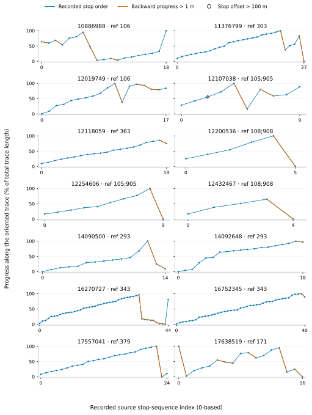
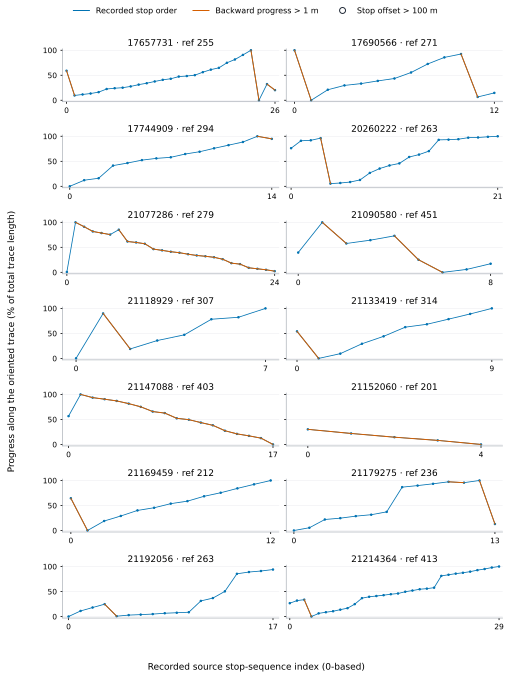

# Closing the earlier validation tasks

**Date:** 1 November 2026. This report supersedes the earlier 20-way length spot check and selected scenario comparison. It records a complete finite-domain validation, and an explicit disposition for every previously excluded strict bus relation. It adds no external transport records.

## 1. Result and effect on the published experiment

**The stored graph and primary route subset were not changed. All published baseline, single-closure and exhaustive paired-closure threshold counts matched the full-walking-node reference.** The existing experiment tables and main figures therefore remain numerically valid; they are not regenerated with invented or silently reordered routes. The validation evidence and explanatory documentation are updated.

The route review closes eligibility decisions for the frozen primary model. It does not claim to repair the source or verify service: all 28 relations remain explicitly excluded under the recorded-order contract, with evidence for each. A geometrically reordered model would introduce a different reconstruction assumption and must be labeled and evaluated separately.

## 2. Complete way, segment and split-edge preservation

The read-only audit examined all 218,322 source road rows and checked every eligible walking way against its source geometry. Source lengths were recomputed in EPSG:32639. Stored split chains were replayed from each original node to the next, verifying their endpoint IDs, interior anchor sequence, nonnegative lengths, and source-segment sum. This detects cancellation that a way-total-only comparison could miss.

- Walking ways checked: **206,474**.
- Source adjacent-node segments checked: **872,879**.
- Stored split edges checked: **930,852**.
- Missing/extra chains or length discrepancies: **0**.
- Largest absolute way-total difference: **2.27374e-13 m**.
- Largest absolute segment difference: **1.81899e-12 m**.
- Absolute audit tolerance: **1e-05 m**.

The source-way set and stored-edge set are reconciled in full. No way or edge was selected by sampling. Numerical differences are many orders below the audit tolerance; coordinates and lengths were not altered to make the audit pass. See [all-lengths.json](validation-2026-11-01/all-lengths.json) and the complete [per-way table](validation-2026-11-01/all-way-lengths.csv.gz).

## 3. Complete solver comparison

Every distinct failed-connection set from the baseline, all single signatures and all paired-closure unions was evaluated with both the compact walking-metric solver and a reference that relaxes the **full walking-node graph**. The reference uses the original reverse boarding-budget recurrence and is compiled with Numba for speed; `fastmath` is disabled and float64 costs are retained. It does not contract walking paths or use the compact transfer matrix.

- Distinct failed sets checked: **27,857**.
- Paired-failure unions covered: **27,849**; single signatures covered: **238**.
- Both mode sets and all **4** boarding layers were compared.
- Connected origins per layer: **64,166**. The other 1,511 building origins retain their common rejected-connector status and never enter either graph search.
- Origin/budget/mode/scenario cells compared: **14,299,778,096**.
- Largest finite absolute cost difference: **1.13687e-12 m**.
- Numeric comparison tolerances: absolute **1e-08 m**, relative **1e-12**.
- Finite/infinite eligibility patterns matched, and **every published W/K threshold count matched exactly**.

There are eight failed sets beyond the paired-union domain: seven single-signature failures not generated by a distinct street pair and the intact case. This explains the scenario count. Shared failed graphs are evaluated once, which preserves every physical pair represented by the exhaustive mapping.

The compiled reference was additionally tested against the original Python solver on 30 generated small graphs at every graph node and boarding layer, and on the actual intact model's origin vectors. The exhaustive comparison is compact versus **compiled full-node reference**, not a claim that the Python interpreter separately ran every scenario. Compilation changes execution speed, not the full-node recurrence, graph, costs or budget semantics. All finite-domain scenario vectors are checked rather than only aggregate counts. Execution used 4 workers and took 1908.2 seconds on the local machine.

See [all-solvers.json](validation-2026-11-01/all-solvers.json) and the [complete scenario/mode table](validation-2026-11-01/all-solver-scenarios.csv.gz). Input and source-code hashes identify the computation. The reference implementation is [full_graph_reference.py](../src/full_graph_reference.py); the census runner is [audit_all_solvers.py](../src/audit_all_solvers.py).

An independent [completeness receipt](validation-2026-11-01/completeness.json) reconciles every stored scenario/mode row against the exact baseline/single/pair domain. It also directly recomputes all three walking-only baseline counts: 7,944, 25,295 and 45,634 buildings at W=500, 1,000 and 2,000 m. All agree with the published baseline.

## 4. Disposition of all 28 excluded bus relations

For every relation, the review inspected frozen OSM relation tags and members, selected stop occurrences, original and reversed trace progress, open/closed topology, numbered ordering roles, alternative stop positions, source road-direction tags, explicit way-member direction roles, and shared stop-area membership at backward transitions.

All 28 traces are open. Every recorded stop sequence contains a backward transition greater than 1 m. Reversing the entire trace leaves 27 sequences mixed; one becomes monotone. No numbered stop-role order was available, and each relation had fewer than two alternative stop-position members. No backward transition was resolved as a shared mapped stop-area pair. One relation also has a stop offset greater than 100 m.

Of these relations, 10 explicitly declare PTv2 and 18 have no version tag. Exclusion under our stricter source-order contract does not establish that every legacy or unspecified relation violates a mandatory PTv2 rule. The registry preserves that distinction rather than calling all 28 relations invalid OSM records.

The reverse-monotone case is relation **21152060**, ref 201. Reversing its path would oppose 108 explicitly one-way source trace edges and 15 edges carried by an explicit direction-constraining member role. Reversing or geometrically sorting its platform list instead would change recorded stop order. That can form a derived-order hypothesis, but it does not verify the operational order. The distance-conflict case is **12107038**, refs 105;905, with a maximum offset of about 360.03 m. No route is called repaired merely by applying a preferred permutation.

| Relation | Ref | Stops | Backward steps | Largest backward step (m) | Max offset (m) | Reverse-trace order | Disposition |
| --- | --- | --- | --- | --- | --- | --- | --- |
| 10886988 | 106 | 19 | 5 | 6,841.49 | 55.75 | mixed | Order exclusion |
| 11376799 | 303 | 28 | 2 | 11,311.07 | 11.48 | mixed | Order exclusion |
| 12019749 | 106 | 18 | 4 | 8,776.88 | 13.27 | mixed | Order exclusion |
| 12107038 | 105;905 | 10 | 2 | 7,277.28 | 360.03 | mixed | Order + distance exclusion |
| 12118059 | 363 | 20 | 1 | 1,179.45 | 13.53 | mixed | Order exclusion |
| 12200536 | 108;908 | 6 | 1 | 6,638.14 | 13.88 | mixed | Order exclusion |
| 12254606 | 105;905 | 10 | 1 | 10,208.06 | 15.46 | mixed | Order exclusion |
| 12432467 | 108;908 | 5 | 1 | 5,011.15 | 12.12 | mixed | Order exclusion |
| 14090500 | 293 | 15 | 2 | 8,389.80 | 9.22 | mixed | Order exclusion |
| 14092648 | 293 | 19 | 1 | 447.39 | 24.33 | mixed | Order exclusion |
| 16270727 | 343 | 45 | 9 | 20,510.17 | 65.37 | mixed | Order exclusion |
| 16752345 | 343 | 41 | 1 | 2,632.15 | 57.31 | mixed | Order exclusion |
| 17557041 | 379 | 25 | 1 | 10,949.84 | 15.41 | mixed | Order exclusion |
| 17638519 | 171 | 17 | 6 | 10,751.30 | 14.59 | mixed | Order exclusion |
| 17657731 | 255 | 27 | 3 | 15,038.95 | 18.49 | mixed | Order exclusion |
| 17690566 | 271 | 13 | 2 | 6,561.29 | 16.80 | mixed | Order exclusion |
| 17744909 | 294 | 15 | 1 | 509.22 | 17.52 | mixed | Order exclusion |
| 20260222 | 263 | 22 | 1 | 22,569.49 | 15.83 | mixed | Order exclusion |
| 21077286 | 279 | 25 | 22 | 2,973.77 | 14.79 | mixed | Order exclusion |
| 21090580 | 451 | 9 | 3 | 2,774.42 | 14.10 | mixed | Order exclusion |
| 21118929 | 307 | 8 | 1 | 7,059.19 | 43.63 | mixed | Order exclusion |
| 21133419 | 314 | 10 | 1 | 2,880.56 | 12.19 | mixed | Order exclusion |
| 21147088 | 403 | 18 | 16 | 1,076.10 | 63.30 | mixed | Order exclusion |
| 21152060 | 201 | 5 | 4 | 282.76 | 10.23 | forward | Order exclusion |
| 21169459 | 212 | 13 | 1 | 4,605.75 | 11.55 | mixed | Order exclusion |
| 21179275 | 236 | 14 | 2 | 8,787.08 | 10.93 | mixed | Order exclusion |
| 21192056 | 263 | 18 | 1 | 5,558.47 | 13.28 | mixed | Order exclusion |
| 21214364 | 413 | 30 | 1 | 5,740.44 | 63.30 | mixed | Order exclusion |





**Figure 8a–b.** Every excluded relation, showing recorded stop-sequence index against progress along its existing oriented trace. Backward progress over 1 m is orange. An open marker flags an offset beyond 100 m. Progress is normalized by each trace's total metric length; the figure is not a geographic map or a service-activity claim. [SVG: cases 1–14](../figures/validation-2026-11-01/all-28-route-orders-part1.svg), [SVG: cases 15–28](../figures/validation-2026-11-01/all-28-route-orders-part2.svg).

The final registry contains **27 order-conflict exclusions and one order-plus-distance exclusion**. It includes source members, each conflicting transition, the geometric-sort candidate and the reason it was not silently substituted. This is a terminal **primary-model eligibility decision**, not a statement that the source is permanently irreparable or that the service does not operate. The quality limitation remains explicit: the primary model contains 11 bus and 14 rail relations.

OSM documentation supports treating stop ordering and direction as meaningful route information: [route relations](https://wiki.openstreetmap.org/wiki/Route_relation) and [bus mapping](https://wiki.openstreetmap.org/wiki/Buses). The [PT Assistant routing-helper documentation](https://wiki.openstreetmap.org/wiki/JOSM/Plugins/PT_Assistant/Routing_helper) also describes geometric stop sorting and warns about repeated traversals. Such a tool is an editing/reconstruction operation, not independent evidence of actual service. These references inform interpretation only; no external map records entered the model.

Full evidence: [route-dispositions.json](validation-2026-11-01/route-dispositions.json), [all consecutive-stop transitions](validation-2026-11-01/excluded-route-transitions.csv), and [review code](../src/resolve_route_exclusions.py).

## 5. Reproduction and next stage

After preparing the frozen model:

```bash
python -m pip install -r requirements-validation.txt
python -m unittest discover -s tests -v
python -m research.src.audit_all_lengths
python -m research.src.resolve_route_exclusions
python -m research.src.audit_all_solvers
python -m research.src.make_validation_report
```

The scripts read the frozen dataset and network without changing them. The solver census can take substantial time; it has no sampling or automatic runtime fallback. Validation outputs are separate from the dataset and main experiment outputs.

The previously open controls are now resolved within the frozen primary model: complete preservation audit, complete solver census, and documented final route exclusions. **Next-stage work remains path-level explanation and sensitivity analysis.** Real-world service completeness, legal boundary equivalence, verified entrances, population weights and clinical capabilities remain data/model limitations, not claims established by these checks.

**Follow-up, 2 November 2026:** the path-level explanation and registered sensitivity stage is now [completed in its separate technical record](path-sensitivity.en.md). The next-stage wording above preserves this validation milestone’s original date.
